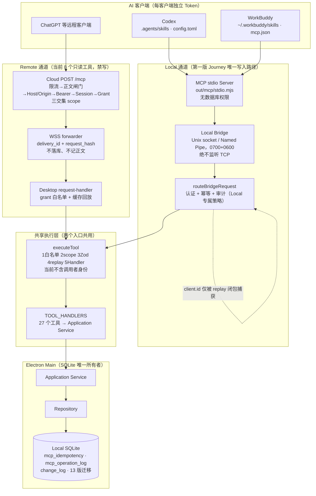
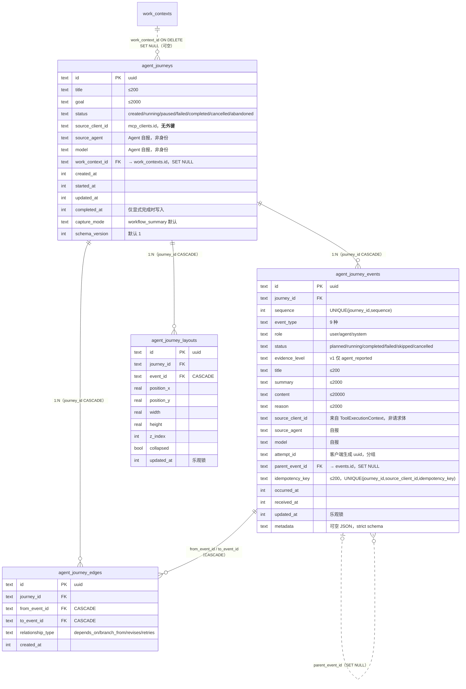
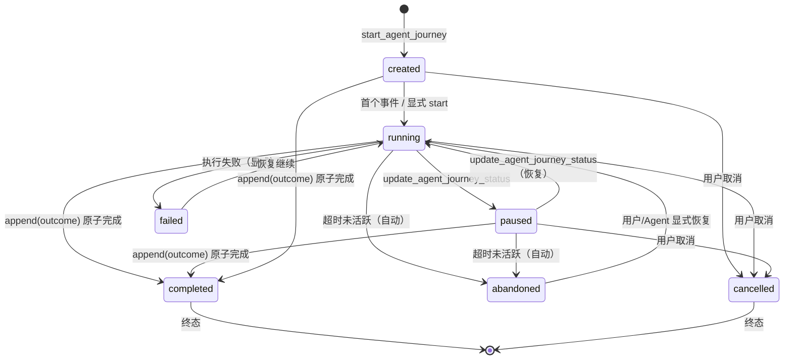
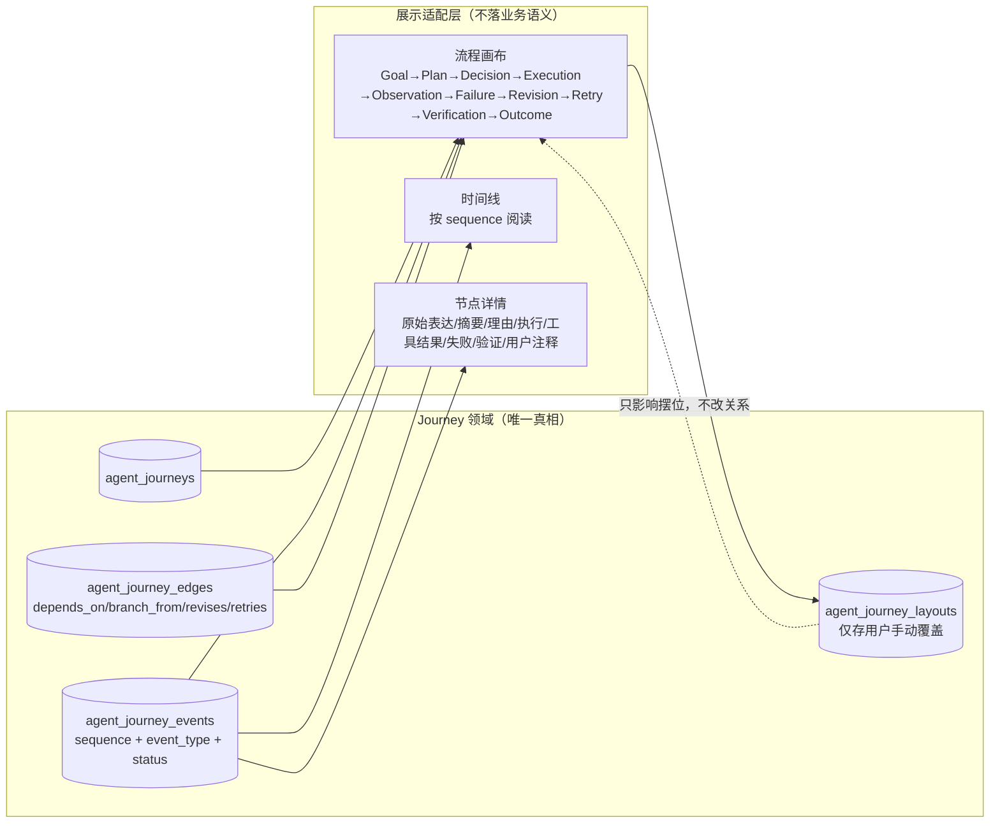
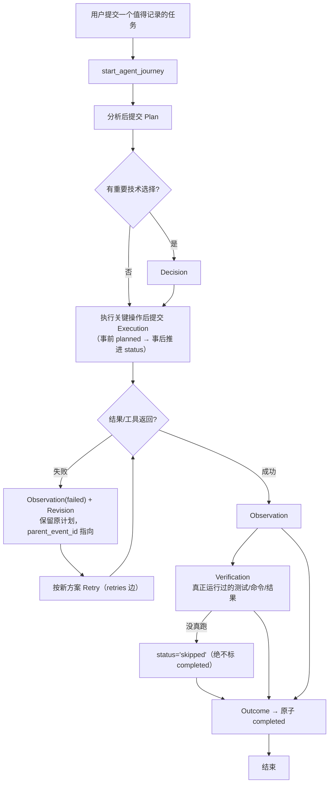

# Agent Journey · R6 数据模型与实现架构设计

> **状态：设计阶段（R6-0 / R6-0.1）——本文档不包含任何已实现的 Journey 业务代码。**
>
> 分支 `feature/remote-mcp` · 基线 `9b0b6169d71fd0edf748fd7f65ac727510139ce8`
> （`git fetch` 后实测，本地 HEAD 与 `origin/feature/remote-mcp` 一致；工作区干净）

## 状态图例（全文统一）

| 标记 | 含义 |
|---|---|
| **[已实现]** | 当前代码里已经存在并运行 |
| **[已验证]** | 本阶段用真实文件 + 行号复核过 |
| **[设计确定]** | 本 ADR 已给出结论，R6-1 起照此实现 |
| **[待实现]** | 设计已定，尚未写代码 |
| **[尚未决策]** | 有意留白，列在 §18 末尾，附解锁条件 |

---

## 1. 产品定位与核心理念

**你的表达与对话即是你的个人资产。** / *Your Expressions. Your Conversations. Your Assets.*

核心闭环：**Capture → Connect → Reflect → Reuse**

Agent Journey 的职责：把一次 Agent 任务中**值得长期保留**的内容沉淀下来——用户原始任务目标、公开的计划与决策理由、执行动作、工具观察、失败与方案调整、真实执行过的验证、最终成果、用户自己的补充。

### 1.1 非目标（明确不做）

- **不采集模型隐藏的内部思维链。** 只保存模型主动向用户公开的分析摘要、计划、决策理由摘要与结论。**[设计确定]**
- 不把 Journey 做成任务管理/看板（与 Work Context 的边界见 §13）。
- 不改变现有 MCP 接入、设备配对、OAuth、CIMD、Cloud 连接流程。
- 不把 Journey 塞进现有 iOS 同步协议（§6 ADR-R6-02）。
- 第一版不开放 Remote MCP 写入（§17）。
- 第一版不开发 Canvas Renderer（§12 只定架构）。

### 1.2 四类内容的归属边界 **[设计确定]**

| 内容 | 归属 | 证据等级 |
|---|---|---|
| 用户原始表达（任务目标、用户注释） | **用户** | `agent_reported`（v1 只有这一条通道，见 §4.3） |
| Agent 对用户公开的摘要 / 决策理由 | **Agent 输出** | `agent_reported` |
| 工具返回 / 测试结果 | **运行结果** | `tool_result`（v1 保留枚举，Main 拒写，见 §4.3） |
| 被运行时真正观察到的操作 | **系统事实** | `runtime_observed`（同上，v1 无来源） |

四者**分开存储、互不覆盖**：`user_input` 一旦写入不可改写；Agent 摘要只能以新事件追加；用户注释用独立 `event_type` + `role` 区分。

---

## 2. 现有代码架构审计

### 2.1 系统架构（现状，全部 **[已实现][已验证]**）



### 2.2 关键结论（逐条带证据）

| # | 结论 | 证据 |
|---|---|---|
| A1 | **工具注册唯一事实来源** = `TOOL_DEFINITIONS`，共 **27 个**工具 | `Desktop/src/shared/mcp/tool-schemas.ts:38-390`；顶层键实测 27 条 |
| A2 | Local 的注册与 Main 二次校验读**同一份** schema | `src/mcp/stdio.ts:91-95` → `src/mcp/tools/*`；`tool-executor.ts:2` |
| A3 | **14 个 scope**（不是 8 个），6 个分组 | `src/shared/contracts/mcp.ts:11-28`（`MCP_SCOPES`）、`:37-57`（`MCP_SCOPE_GROUPS`） |
| A4 | `executeTool` 五步固定不可重排；scope 校验在**执行层内部** | `tool-executor.ts:10-27`（注释）、`:90-186` |
| A5 | **`executeTool` 只收 `scopes`，不收 `client.id`**；身份只被 `replay` 闭包捕获 | `tool-executor.ts:47-56`（`ExecuteToolOptions = {services, scopes, replay?}`）；`request-router.ts:63-69` |
| A6 | `ToolHandler = (services, params) => HandlerResult`——**Handler 拿不到调用者** | `handlers.ts:21`；唯一调用点 `tool-executor.ts:165` |
| A7 | MCP 进程**无数据库权限**；`ToolServices` 不含 `db` | `src/mcp/stdio.ts:12-16`；`tool-services.ts:23-29`；结构测试 `tests/unit/mcp-tools-structure.test.ts:60-93,114` |
| A8 | 一个写调用的完整路径：`stdio → bridge → routeBridgeRequest → executeTool → Handler → Service → Repository → db.transaction` | `bridge-client.ts:53-120` → `request-router.ts:40` → `tool-executor.ts:84` → `handlers.ts` → `record-service.ts:291-343` → `repositories/records.ts:78-111` |
| A9 | 审计表 `mcp_operation_log` **不存参数与正文** | `schema.ts:365-379`；`mcp-bridge/audit-log.ts:9-11` |
| A10 | 事件广播只带域名、**不带 payload**；Renderer 收到后自行重取 | `application-events.ts:17-34`；`main/index.ts:243-247`；`preload/index.ts:42-46` |

---

## 3. 已确认事实与证据（上一轮事实表核对）

### 3.1 通过验证 **[已验证]**

| 上一轮事实 | 核对结果 |
|---|---|
| Codex / WorkBuddy 走 Local MCP stdio | ✅ `README.md:230`、`Desktop/README.md:33`、`:96-126`：Codex 用 `config.toml` 的 `[mcp_servers.brewphase]`，WorkBuddy 用 `mcp.json` 的 `"type":"stdio"`，**两者 `args` 都指向 `out/mcp/stdio.mjs`**，env 均为 `BREWPHASE_MCP_TOKEN` + `BREWPHASE_MCP_USER_DATA_DIR` |
| Electron 未启动时的行为 | ✅ `bridge-client.ts:80-84,131-137`：读不到 `bridge-info.json` → `APP_NOT_RUNNING`；Skill 文档已给出对用户的标准话术 `references/brewphase-mcp.md` |
| `mcp_clients` 只存 `sha256(token)` | ✅ `permission-service.ts:28-30,62`；`README.md:345` |
| `mcp_idempotency` PK = `(client_id, idempotency_key)` | ✅ `schema.ts:386-397` |
| Work Context / 部分实体明确不进 `change_log` 与 iOS 同步 | ✅ `schema.ts:445-448`（work_contexts）、`:496-499`（Personal Direction） |
| 迁移 = 数组 + `user_version`，末版 13 | ✅ `migrations.ts:3-12` 类型、`:594-606`（13 条，`{version:13,name:'reply-intelligence'}`）、`:613-629` 推进与 ROLLBACK |
| Remote 只有 8 个只读工具 | ✅ `shared/contracts/remote.ts:32-40`；`tool-schemas.ts:41,56,63,192,211,222,240,247` 全 `write:false` |
| Canvas `record_id` 必须关联 | ✅ `migrations.ts:149` `record_id TEXT NOT NULL REFERENCES records(id) ON DELETE CASCADE` |
| 数据库**没有**任何 Edge/关系表 | ✅ 全部 `CREATE TABLE` 清单无 edge/connection；权威表述 `Desktop/docs/CANVAS_SPEC.md:71-74` |
| 全仓无通用数据导出功能 | ✅ 仅 `wipeData`；`sync/wipe.ts` 的 `SYNC_ENTITY_TYPES` 只有 **11** 项 |
| 索引有 `## 3a.` 分族先例 | ✅ `REMOTE_MCP_INDEX.md:33`（`3a. 运维族`）、`:39`（`4. 阶段族`）；`^## ` 共 **47** 条 = 编号 1–46 + `3a` |

### 3.2 需要修正的上一轮说法 **[已验证 → 修正]**

| # | 上一轮说法 | 实测修正 |
|---|---|---|
| C1 | 「`MCP_ARCHITECTURE.md` 与 `MCP_SECURITY.md` 仍写 8 scope」 | **`README.md` 同样过期**：`:228`「Per-client authorisation with **8 scopes**」、`:347`「a subset of **8 scopes**」——代码是 **14** |
| C2 | 「Skill 使用符号链接共享主体」 | **仓库内全是普通文件**（`find skills -type l` 无命中）。符号链接是**用户安装时**在目标机上做的（`adapters/codex/README.md` 的 `ln -s ../../skills/…`、`adapters/workbuddy/README.md` 的 `ln -s ~/BrewPhase/skills/…`）。仓库只有一份 canonical source |
| C3 | 「idempotency 表存什么」未说明工具名 | 表里**有 `tool_name` 列**（`schema.ts:392`），但 **PK 不含它** → 同一客户端用同一个 key 跨工具提交会命中 `IDEMPOTENCY_KEY_REUSE`。这正是 §11 要回答的命名空间问题 |
| C4 | 「幂等与业务事务」未核 | **`recordIdempotency` 在 Handler 返回之后、独立语句执行**（`request-router.ts:104-111`），与业务 INSERT **不在同一事务** → 崩溃窗口内可重复创建。Journey 必须消除这个窗口（§11.4） |
| C5 | 「`executeTool` 是否保留身份」未核 | **不保留**。`ExecuteToolOptions` 只有 `services/scopes/replay`（`tool-executor.ts:47-56`）；`client.id` 只作为 `replay` 闭包的捕获值（`request-router.ts:67`）。这是 §5 ADR-R6-01 的出发点 |
| C6 | 「Journey 可循 Work Context 先例做本地存储」 | ✅ 成立，且补充：`wipe.ts` **完全不含** `work_context`（grep 计数 0）→ Journey 的"整库清除"必须单独设计（§16） |
| C7 | 「`Journey` 命名无冲突」 | 需细化：`PERSONAL_DIRECTION_SPEC.md:7` 是品牌口号「Your journey, at your own pace.」、`:388` 是 Personal Direction 的一个板块名 **Journey Forecast**（与 `Current Activity` / `Next Best Move` 并列）。与新功能**不同域**，但 UI 文案需避让（§5.1） |

### 3.3 本阶段新增核对的事实 **[已验证]**

- **Remote 身份是可用的**：`remoteGrantSchema` 含 `client_id`（`shared/contracts/remote.ts:266-277`）；`InstalledGrant` 含 `clientId/grantCtx/boundUserId`（`grant-context.ts:28-36`）；`request-handler.ts:175-195` 在 `executeTool` **之前**就完成 grant 回查。
- **Remote 没有持久幂等**：`request-handler.ts:441` `idempotencyKey: null`；去重靠 `grant_ctx + delivery_id` 内存缓存（`result-cache.ts:78-81`）。
- **OQ-16 原文**：`REMOTE_MCP_ARCHITECTURE_DESIGN.md:607`——「写工具开放后 HTTP 层如何做发送者约束（DPoP / per-request nonce / mTLS）…**1.5（写工具之前）**…状态 **否**」；推理链 `REMOTE_MCP_SECURITY.md:770-794`，末句「**写工具开放前必须重评**」。
- **Cloud 已有结构性禁令**：`cloud/src/mcp-http/tools.ts:19-24` 注释点名 `create_record`/`update_record`/`create_canvas` 不得出现；门禁测试 `cloud/tests/mcp-http/schema.test.ts:79-96`。
- **`stage_goals.work_context_id → work_contexts.id ON DELETE SET NULL`**（`schema.ts:566-568`）——这是 §13 要复用的外键先例。
- **既有长度惯例**：`title ≤200`、`goal/summary 段 ≤2000~4000`、`note/content ≤20_000`、`idempotency_key ≤200`（`tool-schemas.ts:16,76-78,142-145,286-287`）。
- **`AuthenticatedClient = { id, name, scopes }`**（`permission-service.ts:26`），`authenticate()` 在 `permission-service.ts:93-110`，无进程缓存。

---

## 4. Agent Journey 领域边界

### 4.1 Journey ≠ Work Context ≠ Canvas Node **[设计确定]**

| | Work Context | Canvas Node | **Agent Journey** |
|---|---|---|---|
| 生命周期 | 跨多任务持续 | 与画布同生 | **一次具体任务** |
| 存什么 | 元信息 + 指向既有实体的引用，**不复制内容** | 摆放实例（位置/尺寸/层级/备注），内容 join `records` | 任务目标 + 事件时间线 + 关系图 |
| 关系表达 | `work_context_resources`（弱引用） | 无（只有 `record_id` 外键） | **`agent_journey_edges`（新表）** |
| iOS 同步 | 不进 `change_log` | 进 `change_log` + 指纹 | **不进（ADR-R6-02）** |
| 是否可含内容 | ❌ 只存摘要字段 | ❌ | ✅ 事件含结构化正文 |

三者互不包含：**不把 Journey 存进 Work Context 的 `summary`**；**不把 Journey Event 伪装成 Record 或 Canvas Note**（§12）。

### 4.2 与 Journey Forecast 的区分 **[设计确定]**

| 概念 | 归属 | 表 | 含义 |
|---|---|---|---|
| **Journey Forecast** | Personal Direction | `directions`/`stage_goals` 派生 | 「当前趋势和可能的阶段变化」，是**方向预测**（`PERSONAL_DIRECTION_SPEC.md:388`） |
| **Agent Journey** | 新域 | `agent_journeys` | 一次 Agent 任务的**执行历程**，是**历史事实** |

- 产品/ UI 称 **Agent Journey**；表名/工具名/Scope 一律带 `agent_journey` 前缀（§5.1），**不复用裸 `journey`**。
- 现有 `Journey Forecast` 的含义、表、文案**一律不改**。
- 代码里避免出现无前缀的 `journey` 标识符（除本域内部局部变量）。

### 4.3 证据模型（Evidence Model）**[设计确定]**

```text
evidence_level : 'agent_reported' | 'runtime_observed' | 'tool_result'
```

- `agent_reported`：Agent 自己提交的过程描述（**默认，且是 v1 唯一可写值**）。
- `runtime_observed`：由客户端真实运行时 Hook / 可靠执行环境观察到的操作。
- `tool_result`：MCP 或测试工具**实际返回**的结果。

**v1 强制约束 [设计确定]**：Main 端写入时**只接受 `agent_reported`**，收到 `runtime_observed` / `tool_result` 一律 `VALIDATION_ERROR`。

理由（这是本设计最重要的一条诚实性约束）：

1. v1 **没有 Hook**（§14：现有 Skill 无任何 Hook 机制），所有 Journey 事件都由 Agent 通过 MCP 主动提交；
2. 因此 Agent 完全可以把自己的说法标成 `tool_result`——**没有任何系统通道能验证它**；
3. 放行这两个值等于**把"我声称跑过测试"包装成"系统观察到它跑了测试"**，正是产品理念要禁止的；
4. 枚举保留另外两个值，是为 R7+ 的 Hook / Adapter 预留，**解锁条件写在 §17**：只有当 Main 自己的观察点（例如 bridge 层记录的真实工具调用）能产生该事件时，才放开对应值，且**绝不接受客户端参数声明**。

**[尚未决策]** `runtime_observed` 的具体观察点选型（bridge 层 / 进程内 Hook / 外部执行环境），留到有真实 Hook 能力的阶段。

---

## 5. ADR-R6-01：Authenticated MCP Caller Context

### 5.1 问题

Journey 必须记录「**哪一个已授权 MCP Client 发起了这条记录**」（`source_client_id`），且**绝不允许从请求体读取**。当前执行链在 `executeTool` 之后就丢失了身份：

```text
routeBridgeRequest
  └─ client = ctx.clients.authenticate(token)      ← 身份在这里诞生 (request-router.ts:56-61)
       ├─ client.scopes  → 传入 executeTool        ✅ 传了
       ├─ client.id      → 只被 replay 闭包捕获    ✅ 只给了幂等表 (request-router.ts:67)
       └─ executeTool(..., { services, scopes, replay })   ← 没有身份 (tool-executor.ts:47-56)
              └─ TOOL_HANDLERS[tool](services, params)     ← Handler 更拿不到 (tool-executor.ts:165)
```

### 5.2 方案比较

| 方案 | 说明 | 结论 |
|---|---|---|
| **A. 扩展 `executeTool()` 的可信执行上下文** | 在 `ExecuteToolOptions` 增加 `context`，由 Handler 第 3 参接收 | ✅ **采纳** |
| **B. 为 Journey Service 注入本次调用的 client identity** | Service 构造时绑 identity | ❌ Service 是**单例长生命周期**（`main/index.ts` 装配一次），绑定 = 变成全局状态 |
| **C. Handler 里读全局「当前 MCP Client」** | `let currentClientId` | ❌ **明令禁止**：Main 是多客户端、多请求的长期进程，全局可变身份会并发互相覆盖，导致**事件归属错误**（把 A 客户端的事件记到 B 名下） |

### 5.3 决策 **[设计确定]**

**采纳 A**，类型如下（放在 `shared/contracts/mcp.ts`，与 `MCP_SCOPES` 同层）：

```ts
/** 一次工具调用的可信调用者上下文。**只能由认证后的入口构造**。 */
export type ToolExecutionContext = {
  channel: 'local' | 'remote'
  actor:
    | { kind: 'mcp_client'; clientId: string }                 // Local：mcp_clients.id
    | { kind: 'remote_grant'; clientId: string; grantCtx: string } // Remote：grant.client_id + grant_ctx
}
```

**规则（全部 [设计确定]）**：

1. `context` 是 `ExecuteToolOptions` 的 **required** 字段 → 类型层面强迫两个调用点都提供；
2. `ToolHandler` 签名扩为 `(services, params, context) => HandlerResult`；**现有 27 个 Handler 无需改动**（TS 允许实现少于形参个数），只有 Journey Handler 读第 3 参；
3. 身份**只从认证后构造**：Local 在 `authenticate()` 成功之后（`request-router.ts:61`）；Remote 在 grant 回查通过之后（`request-handler.ts:195`）；
4. **原始 MCP 参数里没有可信的 `source_client_id`**：Journey schema **根本不定义**该字段，Handler 无视客户端传值；
5. `source_agent` / `model` 是**客户端自报元数据**，只能存在独立字段里，**永远不参与身份判定**；
6. 上下文**按请求构造、按值传递**，不跨请求共享、不可变（`readonly`）；
7. Remote 接入时 `actor.clientId` 取 `grant.clientId`（`grant-context.ts:31`），**不取**请求体；
8. **拿不到可信身份 → Journey 写入一律拒绝**（`UNAUTHORIZED`），**不允许**静默伪造或降级成匿名。

### 5.4 最小未来代码变更位置（R6-2）**[待实现]**

| 文件 | 改动 | 影响面 |
|---|---|---|
| `shared/contracts/mcp.ts` | 新增 `ToolExecutionContext` 类型 | 纯新增 |
| `application/mcp-tools/tool-executor.ts` | `ExecuteToolOptions` + `context`（required）；`:165` 传第 3 参 | **2 个生产调用点**（`request-router.ts:63`、`request-handler.ts:316`）+ **3 个测试调用点**（`tests/integration/mcp-tool-executor.test.ts:327,330,342`） |
| `application/mcp-tools/handlers.ts` | `ToolHandler` 加第 3 形参 | 27 个现有 Handler **零改动**（可选参数位） |
| `mcp-bridge/request-router.ts` | 构造 `context` | Local 侧 1 行 |
| `remote/request-handler.ts` | 构造 `context`（Remote 侧） | Remote 侧 1 行 |

> 结论：**不改认证、不改 scope 校验、不改幂等、不改审计**，只把「已经在入口处拿到的身份」继续往下传一层。
> 结构测试 `tests/unit/mcp-tools-structure.test.ts` 的既有断言（`ToolServices` 无 `db`、路由必须经 `executeTool`）**不受影响**。

---

## 6. ADR-R6-02：Local-first 与 Remote 扩展路线

### 6.1 决策 **[设计确定]**

**采用方案 C（分层）**，第一版**只走 Local MCP**：

```text
Codex / WorkBuddy
      │  Local MCP stdio
      ▼
BrewPhase MCP Server（无数据库权限）
      │  Local Bridge（Unix socket / Named Pipe）
      ▼
Electron Main
      │  认证 → Scope → Zod
      ▼
executeTool（共享执行层，含 ToolExecutionContext）
      │
      ▼
Agent Journey Application Service   ← 未来 Remote 复用的就是它
      │
      ▼
Agent Journey Repository → Local SQLite → Journey 可视化（Canvas / 时间线 / 详情）

Remote MCP（未来）──► 同一个 Journey Application Service（不是重新实现）
```

**采纳理由**：

1. Codex 与 WorkBuddy **当前都是 Local stdio**（§3.1），第一版的写入需求**全部**落在 Local；
2. Local 已具备完整防线：逐客户端 Token + 14 scope + `executeTool` 第 2 步 scope 校验 + Zod 二次校验 + 幂等 + 审计 + `ToolServices` 不含 `db`；
3. Remote 尚未完成 **OQ-16 发送者约束**（§17），此时开写等于降低安全要求；
4. 分层保证**只有一份业务实现**：Remote 将来调用同一个 Service，不复制逻辑。

### 6.2 第一版硬约束 **[设计确定]**

1. Journey 写入**只经 Local MCP**；
2. 复用现有 `mcp_clients` Token 与逐客户端 Scope；
3. 认证/权限校验全部由 Main 完成（`routeBridgeRequest` + `executeTool`）；
4. Journey Service **不暴露给 MCP 进程**（与 `ToolServices` 不含 `db` 同一纪律）；
5. 所有写入经 Application Service + Repository；
6. **`REMOTE_TOOLS` 保持 8 个只读**，不扩大；
7. Cloud Remote MCP 工具列表不变；
8. Remote 未来接入时**调用同一 Application Service**。

---

## 7. Journey 数据模型

### 7.1 命名定稿 **[设计确定]**

| 层 | 名称 |
|---|---|
| 产品 / UI | **Agent Journey** |
| 表 | `agent_journeys` / `agent_journey_events` / `agent_journey_edges` / `agent_journey_layouts` |
| Scope | `agent_journey:read` / `agent_journey:write` |
| MCP 工具 | `start_agent_journey` / `append_agent_journey_event` / `update_agent_journey_event` / `update_agent_journey_status` / `list_agent_journeys` / `get_agent_journey` |
| 契约类型 | `AgentJourney` / `AgentJourneyEvent` / `AgentJourneyEdge` |
| Domain 事件名（`AppDomain`） | `'agentJourneys'` |

**一律带 `agent_journey` 前缀**，与 Personal Direction 的「Journey Forecast」彻底分开（§4.2）。

### 7.2 ER 图



> **`source_client_id` 刻意不建外键**：撤销/删除 MCP Client 时**绝不能**连带删除用户的历史资产。
> 现有先例：`mcp_operation_log.client_id` 同样无外键（`schema.ts:363` 注释「撤销客户端不删历史」）。

### 7.3 字段分层（拒绝大 JSON）**[设计确定]**

| 类别 | 落列方式 | 例子 |
|---|---|---|
| 可查询 / 可过滤 | **真实列 + 索引** | `event_type`、`status`、`role`、`evidence_level`、`sequence`、`attempt_id`、`occurred_at` |
| 身份 | 真实列 | `source_client_id`、`source_agent`、`model` |
| 人读正文 | **分字段**，各自限长 | `title≤200` / `summary≤2000` / `content≤20000` / `reason≤2000` |
| 关系 | 独立列 | `parent_event_id` |
| 可选扩展 | `metadata TEXT NULL`，Zod **`.strict()`** + `schema_version` | 非核心、不参与查询的补充信息 |

**`stage` 不落库**：它只是 `event_type` 的粗分组（`user_input→input`；`plan`/`decision`/`revision→plan`；`execution`/`observation→execute`；`verification→verify`；`outcome→outcome`；`user_annotation→annotate`）。派生而非存储，避免两套分类漂移。**[设计确定]**

**索引 [设计确定]**：

- `agent_journeys(status, updated_at)` — 列表与超时扫描
- `agent_journeys(work_context_id)` — 按上下文查
- `agent_journey_events(journey_id, sequence)` — 时间线主查询
- `agent_journey_events(journey_id, event_type)` — 按类型过滤
- `agent_journey_events(journey_id, attempt_id)` — 执行尝试分组
- `UNIQUE(journey_id, sequence)` — 顺序兜底
- `UNIQUE(journey_id, source_client_id, idempotency_key)` — 重复提交兜底
- `UNIQUE(journey_id, event_id)`（layouts）
- `UNIQUE(journey_id, from_event_id, to_event_id, relationship_type)`（edges，防重复边）

**删除策略 [设计确定]**：`journeys → events / edges / layouts` 全部 `ON DELETE CASCADE`；`events.parent_event_id` 用 `SET NULL`（**链接可断、内容不丢**）；`edges.from/to` 用 `CASCADE`（关系两端缺一即无意义）；`work_context_id` 用 `SET NULL`（§13）。

**migration [设计确定]**：追加 `{ version: 14, name: 'agent-journeys', sql: ... }` 到 `migrations.ts:594-606` 末尾，**只追加、不改旧版**；同步在 `schema.ts` 补 Drizzle 定义（沿用 `// MARK: - xxx（migration N）` 惯例）。**本阶段不修改 migration。**

---

## 8. Event 与 Edge 关系

### 8.1 事件类型（9 种）**[设计确定]**

`user_input` · `plan` · `decision` · `execution` · `observation` · `revision` · `verification` · `outcome` · `user_annotation`

### 8.2 Event 模型选型：**选 B（追加式事实为主干）** **[设计确定]**

任务书给出两种模型：

- **A**：单条 Event 从 `planned` 更新到 `running`/`completed`/`failed`；
- **B**：重要事实以**追加事件**记录，用 `attempt_id` / `parent_event_id` 连接执行开始、观察与结果。

**结论：以 B 为主干。** 理由——个人资产的长期可信性建立在「已记录的事实不被改写」之上：

| 规则 | 含义 |
|---|---|
| B1 | 执行结果、失败原因、方案调整、验证结论**各自是独立事件**，写入后不回写 |
| B2 | 失败**永不**通过改写旧事件来隐藏；调整用 `event_type='revision'` 新增，并以 `parent_event_id` 指向被修订的 `plan`/`decision` |
| B3 | 重试用 `event_type='execution'` 新增 + `retries` 边指向前一次，旧失败事件原样保留 |
| B4 | 同一次执行尝试的「开始」与「结果」用同一 `attempt_id` 成对，查询时聚合，不覆盖 |

**A 只作为受限的生命周期标记保留**（不是并列方案，而是 B 的一个字段）：

- 只有 `execution` / `verification` 两类事件的 `status` 会推进：`planned → running → completed|failed|skipped|cancelled`；
- `user_input`/`plan`/`decision`/`observation`/`revision`/`outcome`/`user_annotation` **创建即 `completed`**（它们是陈述，不是执行）；
- `status` **单调不可逆**，终态 `completed|failed|skipped|cancelled` 不得再变；
- **改 `status` 不允许改 `content`/`summary`/`reason`/`title`**——这些字段在 `update` 的 schema 里**根本不出现**（§10）。

> 这样「不可变事实」与「可推进的流程状态」被结构性分开，不给"改写历史"留入口。

### 8.3 Edge 关系：v1 只做 4 种 **[设计确定]**

| 关系 | v1 | 说明 |
|---|---|---|
| `depends_on` | ✅ | Execution/Verification 依赖某个 Decision |
| `branch_from` | ✅ | 方案分支：新分支从被放弃的计划上长出 |
| `revises` | ✅ | `revision → plan/decision`，历史不丢 |
| `retries` | ✅ | 新 execution → 失败的 execution |
| `follows` | ❌ **不落 Edge** | 顺序由 `sequence` 单一事实来源推导；再存一份会形成**两套顺序真相**，重排时必然漂移 |
| `supports` / `produces` | ⏭ v2 | 语义丰富但无 UI 消费方；先存等于制造无人读的关系数据 |

**约束 [设计确定]**：边两端必须属于**同一 journey**（表级以 `journey_id` 参与唯一索引 + Service 层校验）→ **杜绝跨 Journey 引用造成越权读取**；Edge 与 `sequence` 完全独立于 Canvas 坐标（§12）。

---

## 9. Journey 生命周期状态机

### 9.1 状态图



### 9.2 转移规则 **[设计确定]**

| 从 → 到 | 触发 | 允许 |
|---|---|---|
| `created → running` | 首个事件写入时自动；或显式 status 更新 | ✅ |
| `running ⇄ paused` | `update_agent_journey_status` | ✅ |
| `running → failed` | 显式失败 | ✅ |
| `failed → running` | 恢复（Agent 中断后继续） | ✅ |
| `running/paused → abandoned` | **自动超时**（`updated_at` 超阈值） | ✅ |
| `abandoned → running` | 显式恢复（数据仍在） | ✅ |
| `created/running/paused → completed` | `append(event_type='outcome', journey_status='completed')` **同一事务** | ✅ |
| `* → cancelled` | 用户取消（除终态外） | ✅ |
| **`completed → *`** | — | ❌ **终态，禁止** |
| **`cancelled → *`** | — | ❌ **终态，禁止** |

**终态 = `completed` / `cancelled`**。`failed` 与 `abandoned` **不是终态**——它们必须可恢复，否则"Agent 中断后恢复"就无从谈起。

### 9.3 中断、恢复与超时清理 **[设计确定 + 尚未决策项]**

- **绝不自动 `completed`**：只有显式提交 Outcome 才置 `completed`。Agent 进程崩溃时 Journey **停在 `running`**，不会被误标为完成。**[设计确定]**
- **恢复**：`list_agent_journeys` / `get_agent_journey` 可查任意状态；恢复 = 把 status 改回 `running`（`failed`/`abandoned`/`paused` 均可）。
- **超时清理**：`running`/`paused` 且 `now - updated_at > 阈值` → 自动 `abandoned`（**只改状态，不删数据**），由一次惰性扫描在 `list/get` 时顺带完成，避免引入常驻定时器。
- **[尚未决策]** 超时阈值的具体秒数（建议起点 24h，R6-1 按真实任务时长定）；
- **[尚未决策]** 是否需要独立的后台扫描器，还是仅惰性判定。

### 9.4 Event 状态机 **[设计确定]**

```text
planned ──► running ──► completed | failed
   │            │
   ├──────────► skipped
   └──────────► cancelled
终态：completed / failed / skipped / cancelled（不可逆）
```

`skipped` 用于「计划了但没执行」——**未执行的验证必须标 `skipped`，绝不允许标 `completed`**（§18 用例 T7/T14）。

---

## 10. MCP 工具协议

> **本节是接口草案。本阶段不修改 `TOOL_DEFINITIONS`、不新增工具、不新增 Scope。**

### 10.1 第一版最小集合：**6 个** **[设计确定]**

| # | 工具 | 类型 | Scope | 幂等键 | 写库 | 触发 `app:changed` |
|---|---|---|---|---|---|---|
| 1 | `start_agent_journey` | 写（create） | `agent_journey:write` | ✅ 必填 | ✅ | ✅ `agentJourneys` |
| 2 | `append_agent_journey_event` | 写（create） | `agent_journey:write` | ✅ 必填 | ✅ | ✅ `agentJourneys` |
| 3 | `update_agent_journey_event` | 写（update） | `agent_journey:write` | ❌（乐观锁 `expected_updated_at`） | ✅ | ✅ `agentJourneys` |
| 4 | `update_agent_journey_status` | 写（update） | `agent_journey:write` | ❌（乐观锁 `expected_updated_at`） | ✅ | ✅ `agentJourneys` |
| 5 | `list_agent_journeys` | 读 | `agent_journey:read` | — | ❌ | ❌ |
| 6 | `get_agent_journey` | 读 | `agent_journey:read` | — | ❌ | ❌ |

### 10.2 几个刻意的取舍 **[设计确定]**

| 问题 | 结论 | 理由 |
|---|---|---|
| `complete_agent_journey` 要不要单列 | **不单列**。`append_agent_journey_event` 收 `event_type='outcome'` 且 `journey_status='completed'` 时，**在同一个事务里**插事件 + 置 completed | 原子：不会出现「有 Outcome 但 Journey 还 running」；少一次工具调用 |
| `pause` / `resume` 要不要各一个 | **合并为 `update_agent_journey_status`** | 同一语义、同一乐观锁、同一审计形状；分两个只会多两份 schema |
| 要不要 `update_agent_journey_event`（改事件） | **要，但入参只有 `event_id` + `status` + `expected_updated_at`**。`title/summary/content/reason` **不在 schema 中 → 结构上无法改写历史事实** | 需要推进 `execution`/`verification` 的生命周期与标 `skipped`；而事实字段根本不给入口 = 不可变性由**类型**保证，不靠自觉 |
| 要不要 `delete_agent_journey_event` | **v1 不做** | 删除只在 Journey 粒度（§16），避免"删一条事件毁掉一条修订链" |
| 分页 | `list` 用 `limit≤50 / offset`（沿用 `recordPage` 惯例）；`get` 返回 journey + events（按 `sequence` 升序）+ edges + layout | 响应可控；事件过多时 `get` 支持 `event_types` / `since_sequence` 过滤 |

### 10.3 工具明细草案

**1. `start_agent_journey`** · scope `agent_journey:write` · **幂等：必填 `idempotency_key`（≤200）**

```ts
input: z.object({
  title: z.string().trim().min(1).max(200),
  goal: z.string().max(2_000).optional(),
  work_context_id: z.string().uuid().optional(),
  source_agent: z.string().max(120).optional(),   // 自报元数据，非身份
  model: z.string().max(120).optional(),          // 自报元数据，非身份
  idempotency_key: idempotencyKey                 // 复用 tool-schemas.ts:16
})
output: { journey: AgentJourney, created: boolean, replayed?: boolean, sync_status: 'desktop_local_only' }
```
- 幂等：同 key 同 digest → 返回原 journey（`created:false`）；同 key 异 digest → `IDEMPOTENCY_KEY_REUSE`。
- 身份：`source_client_id` = `ToolExecutionContext.actor.clientId`（**schema 无此字段**）。
- 错误码：`VALIDATION_ERROR` / `PERMISSION_DENIED` / `UNAUTHORIZED` / `IDEMPOTENCY_KEY_REUSE` / `NOT_FOUND`（work_context 不存在）/ `STALE_RECORD` / `INTERNAL_ERROR`。

**2. `append_agent_journey_event`** · scope `agent_journey:write` · **幂等：必填**

```ts
input: z.object({
  journey_id: z.string().uuid(),
  event_type: z.enum(['user_input','plan','decision','execution','observation',
                      'revision','verification','outcome','user_annotation']),
  // **不暴露 role / evidence_level**（R6-1.1 已实现推导，见下）。
  // status 可选且**不设通用默认值**：默认由 Service 按 event_type 决定——
  // 陈述类 completed、执行类 planned。在 Zod 上写死 default('completed')
  // 会把执行类事件直接建成终态，绕过整个状态机。
  status: z.enum(['planned','running','completed','failed','skipped','cancelled']).optional(),
  title: z.string().trim().min(1).max(200),
  summary: z.string().max(2_000).optional(),
  content: z.string().max(20_000).optional(),
  reason: z.string().max(2_000).optional(),
  attempt_id: z.string().uuid().optional(),
  parent_event_id: z.string().uuid().optional(),
  edges: z.array(z.object({
    to_event_id: z.string().uuid(),
    relationship_type: z.enum(['depends_on','branch_from','revises','retries'])
  })).max(8).optional(),
  source_agent: z.string().max(120).optional(),
  model: z.string().max(120).optional(),
  occurred_at: z.number().int().optional(),     // 仅作展示；顺序永远由 sequence 决定
  metadata: z.record(z.string(), z.unknown()).strict().optional(),
  journey_status: z.literal('completed').optional(), // 仅配合 event_type='outcome'
  idempotency_key: idempotencyKey
})
output: { event: AgentJourneyEvent, edges: AgentJourneyEdge[], sequence: number, replayed?: boolean, sync_status }
```
- **同一事务**：查幂等 → 分配 `sequence` → 插 event → 插 edges →（若 `journey_status='completed'`）更新 journey → 插幂等行 → 提交 → **提交后** `events.emit('agentJourneys')`。
- `source_client_id` 来自 `context`，**不在入参里**；请求体传了也不影响落库身份。
- **`role` 不暴露**：由 `event_type` 推导（`user_input` / `user_annotation` → `user`，
  其余 → `agent`）。先给默认 `agent` 再传给 Service 会让 `user_input` 因角色不一致
  被拒；R6-2 也不开放人工声明 `system`。
- **`evidence_level` 不暴露**：Service 固定写 `agent_reported`。v1 没有可验证的
  Main 运行时观察通道，Agent 不能自行声明 `tool_result` / `runtime_observed`。
- `parent_event_id` / `to_event_id` 必须属于同一 journey，否则 `VALIDATION_ERROR`（防越权）。
- `user_annotation` 的 role 恒为 `user`（由推导保证，不是入参）。

**3. `update_agent_journey_event`** · scope `agent_journey:write` · 无幂等键（乐观锁）

```ts
input: z.object({
  event_id: z.string().uuid(),
  status: z.enum(['planned','running','completed','failed','skipped','cancelled']),
  expected_updated_at: z.number().int()
})
output: { event: AgentJourneyEvent, sync_status }
```
- 仅 `status`；终态不可再改（否则 `STALE_RECORD` 或 `VALIDATION_ERROR`）。
- `expected_updated_at` 不匹配 → `STALE_RECORD`（沿用 `work-context-service.ts:153-157` 的语义）。

**4. `update_agent_journey_status`** · scope `agent_journey:write` · 无幂等键

```ts
input: z.object({
  journey_id: z.string().uuid(),
  // **不暴露 `abandoned`**：R6-1.1 没有超时维护机制，它当前不可达；
  // 给一个永远无法成功的状态操作只会让调用方以为自己成功了。
  // **不暴露 `completed`**：只能由 Outcome 事件在同一事务里完成。
  // **不暴露 `reason`**：Service 没有对应存储字段；要留原因应写成一条独立 Event，
  // 而不是传进一个没有落点的参数。
  status: z.enum(['running','paused','failed','cancelled']),
  expected_updated_at: z.number().int()
})
output: { journey: AgentJourney, sync_status }
```
- 只接受 §9.2 允许的转移；`completed` 不在此枚举内 → **无法用它改终态**。
- `cancelled` 会把开放中的执行类事件收敛为 `cancelled`（**保留历史，不删事件**，§16）。

**5. `list_agent_journeys`** · scope `agent_journey:read`

```ts
input: z.object({
  status: z.enum(['created','running','paused','failed','completed','cancelled','abandoned']).optional(),
  work_context_id: z.string().uuid().optional(),
  limit: z.number().int().min(1).max(50).optional(),
  offset: z.number().int().min(0).optional()
})
output: { journeys: AgentJourneySummary[], total: number, sync_status }
```

**6. `get_agent_journey`** · scope `agent_journey:read`

```ts
input: z.object({
  journey_id: z.string().uuid(),
  event_types: z.array(z.enum([...9 种])).max(9).optional(),
  since_sequence: z.number().int().min(0).optional(),
  limit: z.number().int().min(1).max(50).optional()   // 与 Service 的分页参数一致
})
output: { journey, events: AgentJourneyEvent[], edges: AgentJourneyEdge[], sync_status }
```
> **不返回 Layout、不接受 `include_layout`**：R6-1 只建了表，没有 Layout
> Repository / 查询逻辑（排期 R6-4）。
>
> **`edges` 不是时间线**：顺序永远由 `events[].sequence` 给出；若按
> `event_types` 过滤，返回的边可能有一端不在 `events` 里——那是**关系**而不是
> 顺序，调用方不得把它当时间线读（§8.3）。

### 10.4 身份上下文来源 **[设计确定]**

| 字段 | 来源 | 可信度 |
|---|---|---|
| `source_client_id` | `ToolExecutionContext.actor.clientId`（Local = `mcp_clients.id`） | **可信**，请求体不可影响 |
| `source_agent`、`model` | 请求体 | **自报元数据**，不参与任何判定 |
| `role` | 请求体 | 受约束（`user_annotation → role='user'`），**不作为真实性证据** |
| `evidence_level` | 请求体 | v1 锁死 `agent_reported` |

---

## 11. Scope 与幂等

### 11.1 Scope **[设计确定，本阶段不修改 `MCP_SCOPES`]**

新增 2 个（总数 14 → 16）：`agent_journey:read`、`agent_journey:write`。

**必须同步的 6 处（漏一处就出"注册了工具却看不到权限分组"）**：

| # | 位置 | 现状 | 动作（R6-2） |
|---|---|---|---|
| 1 | `shared/contracts/mcp.ts:11-28` `MCP_SCOPES` | 14 项 | 追加 2 项 |
| 2 | `shared/contracts/mcp.ts:37-57` `MCP_SCOPE_GROUP_KEYS` + `MCP_SCOPE_GROUPS` | 6 组，**闭合联合类型** | 追加 `agentJourney` 组 + 两个 scope。**这一步不能省**：设置页渲染就是遍历 `MCP_SCOPE_GROUPS`（`SettingsPage.tsx:1486-1502`），漏了就 UI 上无法授权 |
| 3 | `shared/contracts/mcp.ts:73-81` `MCP_SCOPE_PRESETS` | `fullAccess = [...MCP_SCOPES]` **自动包含**；其余三个是显式列表 | **`fullAccess` 无需改**；`personalGrowthCollab` / `personalGrowth` / `recordsOnly` **不加入**（避免静默扩大既有预设的授权承诺） |
| 4 | Renderer i18n 分组文案 | `zh-CN/mcp.ts:25-32`、`en-US` 对应 | 追加 1 组 + 2 条（中英同步，i18n 键集一致性测试会拦截漏翻） |
| 5 | `shared/mcp/tool-schemas.ts` 的 `scope` 映射 | 每个工具一处 | 6 个工具各写一个 |
| 6 | Main 认证与校验 | `permission-service.ts:46-52` 校验 scope ∈ `MCP_SCOPES`；`tool-executor.ts:105-115` 校验 | **零改动**（通用机制自动生效） |

### 11.2 现有幂等机制的真实能力 **[已验证]**

| 维度 | 实测 |
|---|---|
| 表 | `mcp_idempotency`（`schema.ts:386-397`），PK `(client_id, idempotency_key)` |
| 存什么 | `request_digest`（sha256 规范化参数）、`tool_name`、`entity_type`、`entity_id`、`created_at` —— **不存参数原文** |
| 同 key 同 digest | 回放原实体，响应带 `replayed:true`（`request-router.ts:175-209`） |
| 同 key 异 digest | 记审计后抛 `IDEMPOTENCY_KEY_REUSE`（`request-router.ts:155-167`） |
| 不同客户端同 key | PK 含 `client_id` → **互不干扰** ✅ |
| **不同工具同 key（同客户端）** | **PK 不含 `tool_name`** → 会命中 `IDEMPOTENCY_KEY_REUSE` ❌ 潜在误伤 |
| 过期清理 | **无**（全仓无 delete/cleanup/expire） |
| 与业务事务 | **不在同一事务**：Handler 先提交业务，router 再单独写幂等行（`request-router.ts:104-111`） |

### 11.3 命名空间决策：**不加 `tool_namespace` 列** **[设计确定]**

比较：

| 方案 | 结论 |
|---|---|
| PK 改为 `(client_id, tool_namespace, idempotency_key)` | ❌ 改 `mcp_idempotency` 表（本阶段禁止）；且**放松**了既有约束——允许同客户端跨工具复用 key，反而掩盖调用方的键设计错误 |
| 工具内自建独立幂等表 | ❌ 复制机制、两套真相 |
| **保持 PK 不变，用约定命名空间 + 文档强制** | ✅ **采纳** |

**采纳方案**：现有「**同一客户端的 key 全局唯一**」是**更强**的约束，已经能正确处理全部四类场景（同 key 同请求 → 回放；同 key 异请求 → 拒；跨客户端同 key → 互不影响；跨工具同 key → 拒绝，因为这本就是调用方的键设计错误）。

**配套（R6-2 写进工具 schema 描述 + Skill 规范）**：

- `idempotency_key` **必须带域前缀**，建议 `start:<uuid>` / `evt:<uuid>`；
- Skill 生成 key 时**用完整 UUID**（≤200，`tool-schemas.ts:16`），不要用递增序号。

### 11.4 真正需要的最小扩展：**幂等写入进事务** **[设计确定 → R6-1]**

**这不是改表，是改写入时机。**

现有链路的崩溃窗口：

```text
db.transaction { insert(record) }   ← 业务已提交
        ↓  ←—— 此处进程崩溃 ——→
recordIdempotency(...)              ← 幂等行没写
        ↓
重试 → 视为新请求 → 再插一条
```

对 `create_record` 低频无感；对**高频追加事件**会直接违反测试矩阵 T3/T17（"重复提交不产生重复事件"）。

**方案 [设计确定]**：Journey 的写入在 **`AgentJourneyService` 内部开事务**，把四件事一起提交：

```text
BEGIN
  1. lookupIdempotency(clientId, key)   → 命中同 digest 则读回原事件并直接 COMMIT（回放）
  2. sequence = COALESCE(MAX(sequence),0) + 1
  3. INSERT event [+ edges] [+ 更新 journey status]
  4. INSERT mcp_idempotency 行
COMMIT
→ 提交后才 events.emit('agentJourneys')
```

- **不改表结构**：仍用现有 `mcp_idempotency` 与 `recordIdempotency()`（同一 `db` 句柄，事务内调用即可）；
- **不改 `request-router`**：它事后的 `recordIdempotency` 因 `onConflictDoNothing`（`audit-log.ts:84-107`）变成空操作；
- **不改 `executeTool`**：事务归属业务层，与"共享执行层不认识 db"的既有纪律一致。

**不同 Journey Tool 之间的 key 冲突** → 由 §11.3 的命名空间约定 + 现有 `IDEMPOTENCY_KEY_REUSE` 覆盖，无需额外机制。

### 11.5 Sequence 方案 **[设计确定]**

| 方案 | 结论 |
|---|---|
| **(a) 事务内 `MAX(sequence)+1` + `UNIQUE(journey_id, sequence)`** | ✅ **采纳** |
| (b) Journey 级 revision | ❌ 无法定位单事件，语义不对 |
| (c) 自增 ID 与 sequence 分离 | ❌ 自增 ID 全局连续、不按 journey 连续，查询仍要二次排序，等于多一个字段没有收益 |

**采纳 (a) 的事务安全论证**：better-sqlite3 是**同步单写者**，`SELECT COALESCE(MAX(sequence),0)+1` 与 `INSERT` 同处一个 `BEGIN…COMMIT` 内 → 天然串行、无读改写竞态；即使并发穿透，`UNIQUE(journey_id, sequence)` 会让事务**整体回滚**，上层收到可重试错误而不是产生重号。

**绝不用客户端时间排序**：`occurred_at` 是 Agent 声称的发生时刻（时钟不可信、跨客户端乱序），只作展示；**顺序真相 = `sequence`**。

### 11.6 事务边界 **[设计确定]**

| 动作 | 同一事务？ |
|---|---|
| Event insert | ✅ |
| Sequence 分配 | ✅ |
| Edge insert | ✅ |
| Journey status update（completed/paused/…） | ✅ |
| MCP 幂等行 | ✅（§11.4） |
| **`app:changed` 通知** | ❌ **必须在 COMMIT 之后** —— 现有惯例即是如此（`record-service.ts:341` 在 repository 返回后 emit）。回滚时**绝不 emit** |

---

## 12. Canvas 集成 ADR（ADR-R6-03）

### 12.1 问题

| 方案 | 内容 |
|---|---|
| **A** | Journey 独立领域数据 + Canvas 提供**独立展示适配层** |
| **B** | 把现有 Canvas 升级为通用 Graph（Record Node / Note Node / Journey Event Node…） |

### 12.2 决策：**选 A** **[设计确定]**

**决定性证据（全部 [已验证]）**：

1. **`canvas_nodes.record_id` 是 `NOT NULL` + `REFERENCES records(id) ON DELETE CASCADE`**（`migrations.ts:149`）。Journey Event 不是 Record → 走 B 就必须把该列改成可空 = **修改现有 Canvas 数据表（本阶段禁止，且会动摇 iOS 侧同构模型 `BrewPhase/Models/CanvasNode.swift:16-62`）**。
2. **数据库里根本没有 Edge 表**：`CANVAS_SPEC.md:71-74`「**当前事实：数据库里没有任何关系持久化模型**…因此本阶段不画任何线」。Journey 必须有边 → **无论选 A 还是 B 都要新建表**，B 并不省事。
3. **`canvas_nodes` 进 iOS 同步**：实体 `canvasNode` 在 `snapshot-importer.ts:80-92` 白名单内，指纹含 `position_x/position_y/width/height/z_index/annotation`（`:202-208`），且每次写都 `recordChange`。把 Journey 塞进去 = **把用户任务正文拖进 iOS 同步协议**（明确禁止）。
4. **MCP 不允许指定坐标**：`add_record_to_canvas` 描述明写 "BrewPhase computes the initial position"，`create_canvas_note` 明写 "do not provide coordinates"（`tool-schemas.ts:265-291`）。→ **布局本来就是展示层数据**，与 A 的"布局独立于业务"完全一致。
5. `canvas_notes` 是 `desktop_local`（指纹恒 `null`，`snapshot-importer.ts:138-142`），但仍**绑定画布**、无类型、无证据字段、无关系 —— 表达不了 Journey Event。

**A 的其余收益**：不破坏现有 Node/Note/Stroke；Edge 与布局彻底分离；同一份 Journey 数据可同时服务 **Canvas 流程图 / 时间线 / 详情页**；未来 iOS 若要展示只需新增读模型，不必改同步协议。

### 12.3 展示架构 **[设计确定，R6-4 实现]**



**核心原则 [设计确定]**：**业务 Edge 与 Canvas Layout 分离**——拖动节点只写 `agent_journey_layouts`，**永不**改 `sequence` 或 `agent_journey_edges`。

| 项 | 决定 |
|---|---|
| 默认布局 | 纯函数按 `event_type` 分层（左→右 DAG），同一 `sequence` 竖排；`revision`/`retries` 用 `branch_from` 折到下一层 |
| 节点尺寸 | 按类型给默认宽高（如 240×140），详情在侧栏展开，不撑大画布 |
| 分支 | 由 `branch_from`/`revises` 边驱动换行；`follows` 不参与（§8.3） |
| 折叠 | `agent_journey_layouts.collapsed` 标记；默认把 `sequence` 连续的 `execution`+`observation` 折成一组 |
| 详情 | 点击 → 侧栏读 `get_agent_journey(event_types=[该事件])`，**不一次性拉全量** |
| 实时刷新 | `app:changed` → `'agentJourneys'` → Renderer 重取（沿用 `application-events.ts` 只带域名的模式） |
| 手动布局保存 | 写 `agent_journey_layouts`（`UNIQUE(journey_id,event_id)`，乐观锁 `updated_at`），**只写覆盖项，算法默认值不落库** |

**[待实现]** `agent_journey_layouts` 建表排期 **R6-4**（第一版不开发 Renderer，但表结构已在 §7 定死）。

---

## 13. Work Context 关联

**[设计确定]**

| 规则 | 决定 |
|---|---|
| 关系 | `agent_journeys.work_context_id` **可空**，`→ work_contexts.id ON DELETE SET NULL` |
| 复用的先例 | `stage_goals.work_context_id` 已是同一外键行为（`schema.ts:566-568`） |
| 基数 | 一个 Work Context → **多**个 Journey；一个 Journey → 0 或 1 个 Work Context（可独立存在） |
| **删 Work Context 时** | **保留 Journey，仅解除引用**（`SET NULL`）。理由：Work Context 是"项目上下文"，Journey 是**个人历史资产**；删项目不应连带销毁个人记忆 |
| 禁止 | **不得**把 Journey 内容写进 `work_contexts.summary/goal/next_step`（那些字段 ≤2000/≤4000，且语义是"元信息"） |
| 查询 | `list_agent_journeys(work_context_id=…)`；索引 `agent_journeys(work_context_id)` |
| 现有 Work Context 表 | **零改动** |

---

## 14. Codex / WorkBuddy Skill 规范

### 14.1 目录与发现路径 **[已实现（R6-3）]**

```text
skills/
  brewphase-agent-journey/
    SKILL.md                          ← 唯一 canonical source（仓库内是普通文件，非符号链接）
    adapters/
      codex/README.md                 ← .agents/skills/ 与 .codex/skills/ 的 ln -s
      workbuddy/README.md             ← ~/.workbuddy/skills/（或项目级 .workbuddy/skills/）的 ln -s
    tests/
      behavior-scenarios.md           ← 人工行为验收场景（**非自动化测试**）
```

**R6-3 交付状态**：上述 4 个文件**已全部落地**（commit `feat(skills): add BrewPhase Agent Journey skill (R6-3)`）。
`SKILL.md` 为英文主体（与既有 canonical skill `brewphase-life-path/SKILL.md` 一致，description 用于触发匹配）；
两个 adapter 只讲安装与发现路径，**不复制正文**；`tests/behavior-scenarios.md` 明确标注为人工走查用例，
**不被任何测试框架执行**。

- 沿用 `skills/brewphase-life-path` 的先例：**仓库一份主体 + 两个 adapter README 只讲安装**。
- 现有 Skill **无任何 Hook / 运行时拦截机制**（`grep -ri hook skills/` 零命中）→ **[已验证]**
- 两个客户端**都能通过 MCP Tool 手动提交事件**：Local stdio 是唯一通道（§3.1），Skill 只需引导模型调工具。

**核心纪律 [设计确定]**：**第一版以统一 Skill 工作规范 + 显式 MCP 工具调用为基础，不依赖任何 Hook。**
**不能假设 Codex 与 WorkBuddy 具备相同的 Hook 或运行时拦截机制**；未来按各客户端真实能力加 Adapter/Hook，且 **Hook 永远是增强，不是 Journey 正常运行的前提**。

### 14.2 统一工作流程



**何时**不**建 Journey**：简单问答、翻译、小型格式转换、不涉及连续执行的轻量互动、**用户明确要求不记录**。

**禁止清单（写进 SKILL.md「Hard rules」）**：

1. 不每句话写事件、不每个工具调用建事件（只提重要里程碑）；
2. **不在执行前声称执行成功**；
3. **不把未运行的测试标成通过**（必须 `skipped`）；
4. **不把隐藏思维链当成可保存内容**；
5. **不覆盖失败历史**——调整用 `revision` 追加；
6. 不在请求体里传 `source_client_id`（schema 也没这个字段）；
7. 长任务分批提交；中断后用 `list_agent_journeys` / `get_agent_journey` 查询并恢复，而不是新建。

**客户端差异 [设计确定]**：统一协议写在 `SKILL.md`；差异（配置路径、token 获取、是否能列目录）只写在各自 `adapters/*/README.md`。

**[已实现（R6-3）]** 实际 Skill 文件已落地：`skills/brewphase-agent-journey/SKILL.md`（唯一主体）+ 两个 adapter README + `tests/behavior-scenarios.md`，见 §14.1。


### 14.3 R6-3 验证状态

| 项 | 状态 |
|---|---|
| 4 个文件的目录结构与相对路径 | **已验证**（`git diff --check` 通过，路径均为仓库相对路径） |
| `SKILL.md` YAML frontmatter（`name` / `description`） | **已验证** |
| 工具名与入参同 `tool-schemas.ts` 真实 Schema 逐项核对 | **已验证**（六工具、字段、长度上限、`status` 无默认、`skipped` 不可作为创建状态） |
| 状态机同 `agent-journeys.ts` / `agent-journey-service.ts` 真实实现核对 | **已验证**（Journey 与 Event 转移表、终态、`abandoned` 不可达） |
| 幂等键规则同 `mcp_idempotency` 真实约束核对 | **已验证**（PK `(client_id, idempotency_key)` 跨工具全局唯一） |
| **真实 Codex / WorkBuddy 客户端加载验证** | **NOT VERIFIED —— 文档结构已验证，客户端运行时尚未验证** |

**明确未做**（本阶段禁止）：无 Hook、无 MCP 工具改动、无 Migration、无 UI、
未修改 `brewphase-life-path` 等既有 Skill、未写入任何真实 Token 或机器绝对路径。

---

## 15. Capture Mode 与隐私策略

### 15.1 三种模式 **[设计确定]**

| Mode | 内容 | 触发 |
|---|---|---|
| **`workflow_summary`** | 任务目标、公开计划摘要、重要决策摘要、关键执行结果、重要失败与调整、验证结果、最终成果 | **默认**，无需授权 |
| `conversation_capture` | 指定范围内的**原始对话** | **用户在 Desktop 设置里显式授权** |
| `detailed_capture` | 脱敏 + 限幅后的详细执行信息 | 同上，显式授权 |

**关键安全决策 [设计确定]**：**`capture_mode` 不能由 MCP 参数提升。**
`start_agent_journey` 里没有 `capture_mode` 字段；实际生效值 = `min(用户配置, 请求方能力)`，**只有 Desktop 设置页能改用户配置**。
理由：否则任何拿到 `agent_journey:write` 的客户端都能自行扩大采集范围——**Agent 无权给自己提权**。

### 15.2 用户控制 **[设计确定]**

| 能力 | 途径 |
|---|---|
| 暂停本次采集 | `update_agent_journey_status → paused`；同时设置页有全局总闸（沿用远程访问"默认关闭"的思路） |
| 删除单次 Journey | 设置页删除 → §16 的级联删除 |
| 导出完整数据 | §16 JSON / Markdown |
| 查看来源与采集方式 | `source_client_id` / `source_agent` / `capture_mode` / `evidence_level` 全部暴露在详情页 |
| 原始表达不被覆盖 | `user_input` 不可变 + `update_agent_journey_event` schema 不含内容字段 |
| Agent 摘要与用户内容分开 | `role` + `event_type` 双重区分；`user_annotation` 强制 `role='user'` |
| 不默认上传工具原始输出 | **[已验证]** Local 写入只到本机 SQLite；审计表不存参数；Cloud 只转发不落库 |
| 不记录凭证 | **[设计确定]** 见 §15.3 |

### 15.3 敏感信息过滤与限幅 **[设计确定 → R6-1 新建]**

**[已验证]** 当前 Desktop **没有**通用脱敏工具（仅 `sync/pairing-service.ts:135` 的 `sanitizeDeviceName`）；Cloud 有 `logger.redact()`（`cloud/src/logger.ts:13`，键名命中即 `[redacted]`）。

因此 Journey 需要**新建** `sanitizeJourneyContent(text, limits)`（放在 Application Service 侧，**落库前**执行）：

1. **凭证黑名单**（键名 + 形态）：`password`/`passwd`/`secret`/`token`/`api_key`/`authorization`/`cookie`/`private_key`/`BEGIN … PRIVATE KEY`/`BREWPHASE_MCP_TOKEN`/`bp_mcp_*`/JWT 形态/`AKIA…` → 替换为 `[redacted]`；
2. **环境变量**：`KEY=VALUE` 行若 key 命中黑名单 → 整行 `[redacted]`；
3. **路径**：绝对路径保留到父目录 + `<file>`（避免日志泄出用户名/项目结构）；
4. **限幅**：`title≤200` / `summary≤2000` / `content≤20_000` / `reason≤2000`，**超长截断并追加 `…[truncated]`**（不静默丢弃）；
5. 命令行输出只保留前 N 行 + 尾部 M 行（建议 200/50），中间以 `…[N lines omitted]` 标注；
6. 过滤**在 Main 落库前**执行，不是在导出时——否则原始敏感内容仍留在库里。

### 15.4 隐私边界 **[设计确定]**

| 边界 | 内容 |
|---|---|
| 本地 SQLite | Journey 正文、事件、关系、布局 —— **唯一的正文存储** |
| `mcp_operation_log` | **[已验证]** 只存 client/tool/entity/成败/错误码/幂等键，**不存正文**（`mcp-bridge/audit-log.ts:9-11`）→ Journey 不改变这一性质 |
| 导出文件 | 用户主动触发；位置与临时文件清理见 §16 |
| **Cloud 转发链路** | **[已验证]** Cloud 不落库（`cloud/src/db/schema.ts` 无 tool-call 表）、不记正文（`mcp-http/handler.ts:61-75` 只记 tool/status/duration/jti 前 8 位，哨兵测试 `logging.test.ts:58-105`）→ **第一版 Journey 只走 Local，根本不经过 Cloud**，这条边界天然成立 |
| Cloud 定位 | **只转发与协议处理，不是个人知识数据库** |

---

## 16. JSON / Markdown 导出与删除

**[设计确定 → R6-5 待实现]** 本阶段只设计，不开发导出与删除功能。

### 16.1 导出

**JSON 导出**（面向 Agent 二次读取 / 迁移 / 跨模型复用）——**必须保留**：

```jsonc
{
  "schema_version": 1,
  "exported_at": 1774000000000,
  "journeys": [{
    "id", "title", "goal", "status", "capture_mode", "schema_version",
    "source_client_id", "source_agent", "model",      // 来源身份
    "work_context_id",
    "created_at", "started_at", "updated_at", "completed_at",
    "events": [{
      "id", "sequence", "event_type", "stage",         // stage 为派生值，导出时计算
      "role", "status", "evidence_level",
      "title", "summary", "content", "reason",
      "source_client_id", "source_agent", "model",
      "attempt_id", "parent_event_id",
      "occurred_at", "received_at", "updated_at",
      "idempotency_key", "metadata"
    }],
    "edges": [{ "from_event_id", "to_event_id", "relationship_type", "created_at" }],
    "layout": [{ "event_id", "position_x", "position_y", "width", "height", "collapsed" }]
  }]
}
```

- **顺序保证**：events 严格按 `sequence` 升序；**不做按 `occurred_at` 排序**。
- **关系保证**：`edges` 与 `parent_event_id` 原样导出；若导出时某端已不存在，JSON 里**保留关系并标注 `dangling: true`**（而不是静默丢弃）。
- **原始表达保证**：`user_input` / `user_annotation` 的 `content` 原样导出，**不做摘要化**。

**Markdown 导出**（面向人阅读 / 分享 / 归档）：

```markdown
# <title>
> 目标｜状态｜来源 <source_agent> @ <client>｜采集模式｜时间范围
## 时间线（按 sequence）
### 1. [decision] <title>          `agent_reported`
<summary>
> 理由：<reason>
### 2. [verification] <title>      status: failed
…
## 决策摘要 / 执行与验证 / 失败与调整 / 最终成果   ← 按 event_type 分节
## 用户注释                          ← 单列一节，与 Agent 输出分开
```

- **布局不导出为关系**：Markdown 只呈现业务顺序与边语义；若需附布局，单独放在末尾 `<!-- layout: … -->` 注释块，**不影响阅读顺序、不参与关系表达**。
- **范围**：v1 支持「单条 Journey 导出」与「按筛选批量导出」；**整库导出 = 未来扩展 [尚未决策]**。
- **媒体/附件**：v1 Journey **不产生媒体文件**（只有文本）→ 无需处理；若未来 `detailed_capture` 引入附件，需单独 ADR。

### 16.2 删除

| 对象 | 策略 |
|---|---|
| 单条 Journey | `DELETE FROM agent_journeys WHERE id=?` → **级联**删 events / edges / layouts（FK） |
| Journey Events / Edges / Layouts | 随 Journey 级联，**v1 不提供单事件删除** |
| 用户注释 | 也是 event → 随 Journey 删除（用户删的是自己的资产） |
| 导出临时文件 | 导出直接写用户选定路径；若用临时文件则**同一次调用内**用完即删；失败也清理 |
| 搜索索引 / 派生数据 | **[尚未决策]**（v1 无全文索引；若引入需一并列入删除清单） |
| **整个应用数据清除** | **[已验证] 现有 `wipeSyncedData` 的 `SYNC_ENTITY_TYPES` 只有 11 项，且完全不含 `work_contexts`/Personal Direction/AI 对话**（`sync/wipe.ts:29-43`，grep `work_context` 计数 0）→ **Journey 不能塞进 `wipeSyncedData`**（其语义是"同步数据"）。R6-5 需新增**独立的本地资产清除入口**（清单含 `agent_journeys` + 既有 `work_contexts` 等），**[待实现]**；本阶段不改 `wipe.ts` |

**事务 [设计确定]**：删除与 §16 的导出校验都在单个 `db.transaction` 内；删除**不依赖** foreign_keys pragma 是否开启（显式按 `layouts → edges → events → journeys` 顺序删，沿用 `wipe.ts:74` 「不依赖 pragma 当前是否开着」的纪律）。

---

## 17. Remote MCP 后续扩展门槛

### 17.1 第一版结论：**不开放 Remote MCP Journey 写操作** **[设计确定]**

**安全原因（全部 [已验证]）**：

1. **OQ-16 未完成**：`REMOTE_MCP_ARCHITECTURE_DESIGN.md:607` 明确「写工具开放后 HTTP 层如何做发送者约束（DPoP / per-request nonce / mTLS）…**1.5（写工具之前）**…状态 **否**」。
2. **当前没有任何发送者约束**：`/mcp` 的 Bearer 是普通 JWT；推理链 `REMOTE_MCP_SECURITY.md:770-794`——`jti` 是 **Token 级**不是请求级，v1 **不引入** per-request nonce/硬去重，防线是「TLS + 15min TTL + `aud` 绑定 + 每次查 grant/scope + **8 个工具全只读**」，并明确「**写工具开放前必须重评**」。
3. **只读纪律有结构性闸门，写闸门同样存在**：`cloud/src/mcp-http/tools.ts:19-24` 点名写工具不得出现；门禁测试 `cloud/tests/mcp-http/schema.test.ts:79-96` 会因任何写工具混入而转红。
4. Remote **没有持久幂等**（`request-handler.ts:441` `idempotencyKey: null`，去重靠内存 `grant_ctx+delivery_id` 缓存，TTL 60s / 256 条）→ 无法保证跨重试不产生重复事件。
5. Journey 正文**绝不能进 Cloud**；Remote 一旦开放，正文会经过 Cloud 解析、算 `request_hash` 并转发（虽不落库不记日志）。**Local 先行可以让第一版正文完全不经过 Cloud。**

> **不为了让 ChatGPT 等远程模型尽早写入而降低安全要求。**

### 17.2 未来架构 **[设计确定]**

```text
Local MCP ──────────────┐
                        ▼
              Journey Application Service   ← 唯一业务实现
                        ▲
Remote MCP（future）────┘   （复用，不重新实现）
```

### 17.3 解锁门槛（**全部满足**才可实现）**[设计确定]**

1. **OQ-16 决策完成**（DPoP RFC 9449 / per-request nonce / mTLS 三选一并落地）；
2. **发送者约束通过真实验证**（安全测试，非仅单元测试）；
3. 每次请求的身份绑定可信（Bearer ↔ 客户端，不能只靠 Token）；
4. **Cloud + Desktop 双重权限校验**（现已有：Cloud `authorize.ts:98-182` 三交集 + Desktop `request-handler.ts:215-235` 白名单/scope）；
5. **逐 Grant 独立 Scope**（现已有：`remoteGrantSchema` + `InstalledGrant`）；
6. **`delivery_id` 与 Journey 幂等无冲突**：Remote 走的是内存 `grant_ctx+delivery_id` 去重，而 Journey 走 `mcp_idempotency`——**必须定义两层键的组合规则**（建议：Remote 调用时把 `delivery_id` 作为 Journey 的 `idempotency_key` 传入，由 Service 层统一落幂等表）；**[尚未决策]** 具体组合方式需在 OQ-16 定稿后一并确定；
7. Cloud **不保存 Journey 正文**（现已有纪律 + 哨兵测试，需为 Journey 场景补测试）；
8. **撤销授权后立即停止新的 Journey 写入**（现有 `grant_update` 撤销 + `isGrantRevoked` 已能阻断新请求）；
9. Remote 重试**不产生重复事件**（依赖 6）；
10. `ToolExecutionContext.actor.kind='remote_grant'` 身份来自 **已回查的 grant**（`grant-context.ts:28-36`），**不来自请求体**。

**[尚未决策]** 上述第 6 条的键组合方案（待 OQ-16 定稿）。

---

## 18. 测试矩阵与分阶段实施计划

> 本阶段不实现代码，以下为 R6-1 起必须落地的测试计划。

### 18.1 测试矩阵

| # | 用例 | 层级 | 要点 |
|---|---|---|---|
| T1 | 同一 Agent 重复 `start` 不产生重复 Journey | 集成 | 幂等同 key 同 digest → `created:false` |
| T2 | 两个事件并发提交，`sequence` 不重复 | 集成 | 事务内 `MAX+1` + `UNIQUE(journey_id,sequence)` 兜底 |
| T3 | 相同 `idempotency_key` 重复提交不产生重复事件 | 集成 | 幂等行与业务同事务 |
| T4 | **不同客户端不能伪造 `source_client_id`** | **安全** | 请求体传 `source_client_id` 被忽略（schema 无此字段）；断言落库值 = `context.actor.clientId` |
| T5 | 计划修改不覆盖旧计划 | 集成 | `revision` 追加 + `parent_event_id`；旧 `plan` 字节不变 |
| T6 | 失败事件不能被隐藏 | 集成 | `execution(failed)` 永不被改写；`retries` 边可回溯 |
| T7 | **未执行的验证必须 `skipped`，不能 `completed`** | 集成 + Skill 测试 | 状态机拒绝 `planned→completed` 直跳（除创建即 completed 的陈述类） |
| T8 | Agent 中断后可恢复 | 集成 | `running` 超时 → `abandoned`（不删数据）→ 显式 `running`；**绝不自动 `completed`** |
| T9 | 同一 Journey 可建分支与 retry 关系 | 集成 | `branch_from` / `retries` 边 + 跨 Journey 引用被拒 |
| T10 | Work Context 关联正确；**删 Work Context 保留 Journey** | 集成 | `SET NULL` 后 journey 仍在、`work_context_id` 为 null |
| T11 | 用户注释不覆盖 Agent 事件 | 集成 | `user_annotation` 独立行；`role='user'` 强制 |
| T12 | 未授权 Scope 无法写入 | 集成 + **安全** | 无 `agent_journey:write` → `PERMISSION_DENIED`（`tool-executor.ts:105-115`） |
| T13 | **Remote 未满足 OQ-16 时写入被拒** | **安全** | `REMOTE_TOOLS` 不含 Journey 工具 → `TOOL_NOT_ALLOWED`；`schema.test.ts` 门禁转红 |
| T14 | Cloud 日志不出现事件正文与敏感数据 | **安全** | 复用/扩展 `cloud/tests/mcp-http/logging.test.ts` 哨兵断言 |
| T15 | 超大内容与非法类型被拒绝或截断 | 单元 | Zod 超长拒绝；`sanitizeJourneyContent` 截断带 `[truncated]` |
| T16 | 敏感信息过滤 | 单元 + 集成 | 密码/Token/Cookie/私钥/环境变量 → `[redacted]`，**断言原值不在库中** |
| T17 | 删除 Journey 后 events/edges/layouts 按约定清理 | 集成 | 显式顺序删除，不依赖 pragma |
| T18 | JSON 导出保留顺序、来源、关系、原始内容 | 集成 | 按 `sequence`；`user_input.content` 逐字节比对；dangling 边标注 |
| T19 | Markdown 导出可读且用户注释单列 | 集成 | 分节结构断言 |
| T20 | 工具调用重试不重复创建节点 | 集成 | §11.4 事务内幂等（**崩溃窗口**用注入异常验证） |
| T21 | 本地库升级不破坏 Records/Canvas/Coffee/Work Context | 集成 | migration 14 后跑既有全量测试 |
| T22 | **多 Local Client 身份隔离** | 集成 | client A 的事件 `source_client_id` ≠ B；并发提交不串 |
| T23 | 同 key 不同参数 | 集成 | `IDEMPOTENCY_KEY_REUSE` |
| T24 | Canvas 布局与业务关系隔离 | 集成 | 拖动只改 layout；`sequence` 与 edges 不变 |
| T25 | 用户暂停采集 | 集成 + e2e | `paused` 后新事件被拒 |
| T26 | Local MCP 权限拒绝 | 集成 | 无效 Token → `UNAUTHORIZED` |
| T27 | Scope 设置页分组可见 | **e2e** | `MCP_SCOPE_GROUPS` 含 `agentJourney`，UI 能勾选（防"注册了但看不见"） |

**层级归类**：单元（T15/T16 部分）、集成（大多数）、安全（T4/T12/T13/T14/T16/T26）、端到端（T27 + 完整 Skill 流程）。

### 18.2 分阶段实施 **[设计确定]**

| 阶段 | 任务 | 验收 |
|---|---|---|
| **R6-1** | migration 14（4 张表）+ Drizzle schema + Repository + `AgentJourneyApplication Service`（含事务幂等、sequence、sanitize） | T2/T3/T5/T6/T17/T20/T21；`pnpm typecheck/test/build` |
| **R6-2** | `ToolExecutionContext`（ADR-R6-01）+ 6 个 MCP 工具 + 2 个 Scope + 分组/i18n/preset 同步 | T1/T4/T7/T9/T10/T11/T12/T22/T23/T27 |
| **R6-3** | `skills/brewphase-agent-journey/`（SKILL.md + 2 adapters） | Skill 场景测试；Codex 与 WorkBuddy 各自实机跑通一次 |
| **R6-4** | Canvas Journey 可视化适配层 + `agent_journey_layouts` + 详情/时间线 | T24/T25；布局不改业务关系 |
| **R6-5** | JSON/Markdown 导出 + Journey 删除 + Capture Mode 设置 + 敏感过滤接入 + 端到端 | T8/T14/T15/T16/T18/T19/T25 |
| **R7** | Remote MCP 写入安全（OQ-16）与扩展 | §17.3 十条门槛逐条验证 + T13 反向解除 |

**推荐下一阶段先做 R6-1**，理由：数据模型与事务边界是**所有**后续阶段的地基——Scope、工具、Skill、Canvas、导出全部依赖表结构与幂等语义；先把它定死，R6-2 起就不再需要回头讨论"存什么、怎么防重复"。

### 18.3 尚未解决的问题（**[尚未决策]** 汇总）

| # | 问题 | 解锁条件 |
|---|---|---|
| U1 | `running`/`paused` 判定为 `abandoned` 的超时阈值 | R6-1 按真实任务时长实测定（建议起点 24h） |
| U2 | 超时扫描是独立后台任务还是仅惰性判定 | R6-1 结合启动开销与体验决定 |
| U3 | `runtime_observed` / `tool_result` 的真实观察点 | 需存在 Main 侧观察通道（Hook/Adapter），见 §4.3；R7+ |
| U4 | Remote 的 `delivery_id` 与 Journey `idempotency_key` 组合规则 | OQ-16 定稿后一并确定（§17.3 第 6 条） |
| U5 | 整库导出 | 有单条/批量导出的真实使用反馈后 |
| U6 | Journey 是否需要 iOS 同步 | **单独 ADR**，本阶段不进 change_log |
| U7 | 全文搜索索引及其删除清单 | 引入索引时同步设计 |
| U8 | Markdown 导出样式细则 | R6-5 实现期定 |

---

## 19. R6-1 实现约束（Domain Persistence 落地前补充）

> 本节在编写业务代码之前确定，是 R6-1 的**实现契约**；与 §7–§16 冲突时以本节为准。
> 范围：Migration 14 + Drizzle Schema + Repository + `AgentJourneyService` + 事务幂等 +
> 状态机 + 内容脱敏 + 测试。**不含** MCP 工具、Skill、Canvas UI、Remote、导出 UI。

### 19.1 读写权限边界

- `list_agent_journeys` / `get_agent_journey` 对应的 Service 方法是**纯读取**：
  查询过程中**不**自动推进 Journey 状态、**不**执行 `abandoned` 惰性清理、
  **不**写入任何业务数据、**不**做「先改库再把改动结果当查询结果返回」。
- **自动超时状态变更（`running/paused → abandoned`）R6-1 不实现**，后续单独设计
  维护机制。因此 R6-1 中 `abandoned` 是**不可达**状态：既不通过 `updateJourneyStatus`
  设置，也不会被查询触发。状态枚举仍保留该值，只为与 §9 状态机保持同构。
- 读取唯一允许的副作用是**返回数据**；审计（若 R6-2 需要）由调用方在 Service 之外记。

### 19.2 幂等职责划分

| 层 | 职责 |
|---|---|
| `mcp_idempotency` | **MCP 请求级幂等与重放的主要记录**（`request-router` 的 `replay` 钩子读它） |
| `agent_journey_events.idempotency_key` | **事件级唯一性约束**（`UNIQUE(journey_id, source_client_id, idempotency_key)`），是数据库兜底，**不构成第二套重放逻辑** |

- 同一客户端的 `idempotency_key` **仍然全局唯一**（PK `(client_id, idempotency_key)` 不变），
  继续沿用 `start:<uuid>` / `evt:<uuid>` 命名约定（§11.3）。
- **请求摘要必须与 `executeTool` 经 Zod 解析后的完整参数一致**，即包含
  `idempotency_key` 本身；**Application Service 不得根据残缺的业务字段重新拼接摘要**。
  R6-1 由调用方把 `digestParams(parsedParams)` 的结果作为上下文传入，Service 只校验不重算。
- 事务中保存的幂等上下文至少包含：`clientId`、`key`、`toolName`、`requestDigest`、
  `entityType`、`entityId`。
- **`AgentJourneyService` 不得依赖 `mcp-bridge/audit-log.ts`**（业务层反向依赖桥接层
  会把 Local 专属策略拖进领域层）。幂等持久化能力下沉到
  **`database/repositories/mcp-idempotency.ts`**（基础设施/Repository 层），
  `mcp-bridge/audit-log.ts` 改为**转发/再导出**同一批函数：
  - 业务事务可以原子写入幂等记录；
  - `request-router.ts` 的查询与写入路径**保持可用且行为不变**；
  - **不复制两套互不兼容的幂等实现**（同一张表、同一组函数）。
- **R6-1 不修改 `request-router.ts` 的路由与重放分支**；但 **R6-2 必须**做两件事：
  1. 为 `entityType = 'agentJourney'` / `'agentJourneyEvent'` 增加对应的
     `replayIdempotent()` 分支（否则重放会落到 `unknown entity type` 的
     `INTERNAL_ERROR`）；
  2. **`replayFromIdempotency()` 补跨工具幂等键拒绝**：目前它只比对
     `existing.requestDigest !== digestParams(params)`，**没有比对
     `existing.toolName !== toolName`**。于是同一 Client 用同一个 key、
     同一组参数去调两个不同的 MCP 工具时，第二个会被当成「重放」而返回
     第一个工具的结果。R6-2 必须加上该判断并补测试
     （Service 层已经在 R6-1.1 加了同样的边界，见 §19.9）。

  **不能声称 request-router 完全无需扩展。**

### 19.3 隐私与导出语义

- **数据库里只保存完成脱敏后的内容**：`sanitizeJourneyContent` 在**落库之前**执行，
  脱敏前的原始凭证/秘密文本**不写入数据库、不写入审计、不进调试日志**。
- 未来 JSON 导出**直接导出库中的已脱敏内容**，不再二次摘要化、不改变正文；
  **不能承诺恢复已被脱敏的原文**（脱敏是单向的）。
- 正则黑名单是**尽力而为**：它能挡住已知形态，**不是**能发现所有未知凭证的绝对安全保证
  —— 产品文案与测试断言都不得表述为「保证无泄漏」。

### 19.4 `parent_event_id` 与 Edge 的关系

| 表示 | 语义 |
|---|---|
| `agent_journey_events.parent_event_id` | **结构性父子归属**（谁派生自谁，例如 revision 指向被修订的 plan） |
| `agent_journey_edges` | **有明确语义的业务关系**：`depends_on` / `branch_from` / `revises` / `retries` |

- **不得为同一关系自动重复写入两种表示**：调用方显式给 `parent_event_id` 就只写 parent；
  显式给 `edges[]` 就只写 edge。Service **不推导、不镜像**。
- Service 必须校验**两个事件属于同一 Journey**，并禁止自引用与引用不存在的事件。

### 19.5 Event 状态规则（按 `event_type` 区分性质）

**陈述类**（创建即完成，正文不可再改）：
`user_input` · `plan` · `decision` · `observation` · `revision` · `outcome` · `user_annotation`

- 创建时 `status` **只能是 `completed`**；传入其它状态 → `VALIDATION_ERROR`。
- 终态不可逆 → `updateEventStatus` 对它们一律拒绝。

**执行类**：`execution` · `verification`

- 创建时 `status` 只能是 `planned` 或 `running`（**不能**一上来就 `completed`——
  「宣布做完了」和「做完了」必须是两次独立写入，后者带自己的 `expected_updated_at`）。
- 允许的推进：

```text
planned  → running | skipped | cancelled
running  → completed | failed | skipped | cancelled
completed / failed / skipped / cancelled → （终态，不可逆）
```

- `planned → completed` **不被允许**（必须经过 `running`）。
- 其它任何「类型 × 状态」组合 → `VALIDATION_ERROR`。

**证据等级**：v1 **只接受 `agent_reported`**；客户端声明 `tool_result` 或
`runtime_observed` → `VALIDATION_ERROR`。
Agent 自述**仍然是自述**——产品文案与测试断言中**不得**把它描述成「系统已独立验证的事实」。

### 19.6 可信调用上下文（R6-1 不实现 `ToolExecutionContext`）

Service 的写方法接收一个**独立的可信上下文**，业务入参里**没有** `source_client_id`：

```ts
type AgentJourneyCallContext = {
  actor: { kind: 'mcp_client'; clientId: string }   // 只能由认证后的入口构造
  idempotency: { key: string; toolName: string; requestDigest: string }
}
```

- **R6-1 不实现 `ToolExecutionContext`**，也**不使用全局变量**保存当前 Client 身份；
  上下文由调用方按值传入（测试直接构造）。
- R6-2 由认证后的 `ToolExecutionContext` 构造它（§5.4）。
- `source_agent` / `model` 只是客户端自报元数据，**永不参与身份判定**。
- 拿不到可信 `clientId` → 写入一律拒绝，**不允许匿名降级或伪造来源**。

### 19.7 R6-1 改动清单

| 文件 | 改动 |
|---|---|
| `src/main/database/migrations.ts` | 追加 `version: 14, name: 'agent-journeys'`（只新增，不改历史） |
| `src/main/database/schema.ts` | 四张表的 Drizzle 定义 + 索引/外键 |
| `src/main/database/repositories/agent-journeys.ts` | **新增** Repository |
| `src/main/database/repositories/mcp-idempotency.ts` | **新增**：幂等持久化下沉到基础设施层 |
| `src/main/mcp-bridge/audit-log.ts` | 改为再导出上表的幂等函数（行为不变） |
| `src/main/application/agent-journey/agent-journey-service.ts` | **新增** Application Service |
| `src/main/application/agent-journey/sanitize.ts` | **新增** `sanitizeJourneyContent` |
| `src/main/application/events/application-events.ts` | `AppDomain` 增 `'agentJourneys'` |
| `tests/unit/agent-journey-sanitize.test.ts` | **新增** 脱敏单测 |
| `tests/integration/agent-journey-persistence.test.ts` | **新增** 真实 SQLite 集成测试 |
| 本文档 | §19 实现约束 |

**不接入** `ToolServices` / `TOOL_HANDLERS` / `main/index.ts` 装配：R6-1 尚无消费者，
提前塞进 `ToolServices` 会破坏 `tests/unit/mcp-tools-structure.test.ts` 的「恰好 5 个
Service」结构断言，且等同于为 MCP 工具铺路。装配留到 R6-2。

### 19.8 实现期补充决策（写码时确定，与 §19.5/§19.7 一致）
| # | 决策 | 理由 |
|---|---|---|
| 1 | `role` **由 `event_type` 推导**：`user_input`/`user_annotation` → `user`，其余 → `agent`；调用方传了就必须相等，否则 `VALIDATION_ERROR` | 不允许把 `plan` 声明成「用户说的」。`system` 保留为枚举值，留给未来的运行时观察事件 |
| 2 | 执行类事件**创建时**只能是 `planned` 或 `running`，**不能**直接 `completed` | 「宣布做完了」与「做完了」必须是两次独立写入，后者带自己的 `expected_updated_at`（乐观锁） |
| 3 | `planned → completed` **不被允许**，必须经过 `running` | §19.5 的推进表是链条，不是全连接图 |
| 4 | `appendEvent` 只接受 Journey 状态 `created` / `running`（`paused`/`failed`/`abandoned` 先 resume；`completed`/`cancelled` 永久拒绝） | 否则「暂停采集」是假的——paused 期间照样能写就等于没暂停 |
| 5 | R6-1 **只接受 `capture_mode='workflow_summary'`**；`conversation_capture` / `detailed_capture` 直接 `VALIDATION_ERROR` | §15.1 要求这两种必须**用户显式授权**，而 R6-1 没有授权界面。没有闸门就不开这道门 |
| 6 | `updateJourneyStatus` **不接受 `reason` 参数** | 没有对应列；R6-2 若要留原因，应作为一条事件写入，而不是塞进无处安放的入参 |
| 7 | Edge 校验放在**事件插入之后**、幂等写入之前 | 这样任何一条非法边都会把事件插入一起回滚——事务原子性因此**可测**（测试 12 就靠它） |
| 8 | 请求摘要**只校验不重算**：`requestDigest` 必须是 64 位 hex（`digestParams` 的输出形态） | §19.2 禁止 Service 用残缺字段重拼摘要；格式校验是「这个值必须来自 digestParams」的最低保证 |

### 19.9 R6-1.1 加固（持久化不变量）

审查发现的四类问题与定稿修法（**只改不变量，不加功能**）：

| # | 问题 | 定稿修法 |
|---|---|---|
| 1 | 乐观锁用 `Date.now()` 写版本，**毫秒会撞**——快速连续更新时，已经变更过一次的记录仍会被旧请求用同一个 `expectedUpdatedAt` 命中，CAS 形同虚设 | 统一 `nextUpdatedAt(now, previous) = max(now, previous + 1)`，**严格递增**。`previous` 取参与 CAS 的 `expectedUpdatedAt`（WHERE 已保证它等于库内现值），或 `updateJourneyUnchecked` 更新前**重读**当前值——因此同一事务里 `created → running → completed` 连写两次，第二次会继续递增而不是原地踏步。覆盖 `updateEventStatus` / `updateJourney` / `updateJourneyUnchecked` 三条写路径（含取消时的批量推进）。**协议契约不变**：仍是 `expected_updated_at`，不改 MCP 接口 |
| 2 | `redactDeep()` 对敏感父级**继续下钻**：`{authorization:{value:'x'}}` 的子键 `value` 既非敏感键、内容也不匹配任何 Token 正则 → 原样漏出；数组同理 | **方案 A：敏感键命中后整棵子树替换为 `[redacted]`**，不区分原语/对象/数组。比「给每个后代挂敏感祖先状态」更简单、更安全、更好测；只有敏感子树被折叠，普通 metadata 的嵌套与数组原样保留，替换值是普通字符串 → `JSON.stringify` 必然合法 |
| 3 | `goal` 误用 `content` 的 20000 上限，与 §7.2 的 ≤2000 不符 | `JOURNEY_TEXT_LIMITS` 新增独立 `goal: 2_000`，`createJourney()` 用它脱敏+截断；其余字段行为不变 |
| 4 | 幂等上下文只校验「toolName 非空」；且回放只比对 digest | ① **方法与工具名绑定**：`createJourney` 只收 `start_agent_journey`、`appendEvent` 只收 `append_agent_journey_event`，不一致在**任何写入之前**抛 `VALIDATION_ERROR`（业务表与幂等表都不留痕）；② **回放额外比对 `existing.toolName`**，不一致抛 `IDEMPOTENCY_KEY_REUSE`——绝不把一个工具的记录当成另一个工具的成功结果 |
| 5 | `createJourney` 在**幂等检查之前**查 Work Context 存在性 | 校验顺序改为「**先幂等，后依赖**」：命中同 key 同 digest 就直接回放，**即使原 Work Context 已被 `ON DELETE SET NULL` 掉**；只有真正创建新 Journey 时才在事务内查存在性。回放**不重复创建**、**不重复 `emit`** |

**跨工具幂等键的边界**：Service 层已在 R6-1.1 加了判断（上表 #4），但
`mcp-bridge/request-router.ts` 的 `replayFromIdempotency()` **仍然只比对 digest**。
本阶段**不改** MCP Router；该边界与 `agentJourney` / `agentJourneyEvent` 的
`replayIdempotent()` 分支一起记在 §19.2，属 **R6-2 必做**。

---

## 20. R6-2 实现落地（MCP Integration）

### 20.1 改动文件

| 文件 | 改动 |
|---|---|
| `shared/contracts/mcp.ts` | 新增 `ToolExecutionContext` / `LocalToolExecutionContext` / `isLocalToolContext`；`MCP_SCOPES` 14 → **16**；`MCP_SCOPE_GROUP_KEYS` + `MCP_SCOPE_GROUPS` 增 `agentJourney` |
| `shared/mcp/tool-schemas.ts` | 新增 6 个工具（27 → **33**），入参按 §10.3 修正版实现 |
| `main/application/mcp-tools/tool-executor.ts` | `ExecuteToolOptions.context` **必填**；第 5 步把完整 context 传给 Handler |
| `main/application/mcp-tools/handlers.ts` | `ToolHandler` 增第 3 参；6 个 Journey Handler + `requireLocalContext` + **DTO 映射（首次执行与重放共用）** |
| `main/application/mcp-tools/tool-services.ts` | 增 `agentJourneys`（仍**不含** `db` / `clients`） |
| `main/mcp-bridge/request-router.ts` | 认证后构造 Local context；`IDEMPOTENT_TOOLS` +2；`replayFromIdempotency` **先比 `toolName` 再比 digest**；`replayIdempotent` 增 `agentJourney` / `agentJourneyEvent` 分支 |
| `main/remote/request-handler.ts` | **只补 context**（grant 回查全部通过后由 `InstalledGrant` 构造 `remote_grant`） |
| `main/index.ts` | 构造 `AgentJourneysService`（复用同一 `ApplicationEvents`），注入 Bridge `RouterContext` 与 Remote `ToolServices` |
| `mcp/tools/agent-journey.ts`（**新增**）+ `mcp/stdio.ts` | 6 个工具的 stdio 注册——**见 20.3 的范围说明** |
| i18n `mcp.ts` / `onboarding.ts`（zh + en） | 分组名 `agentJourney`、两条 `scopeLabel`、`fullAccess` 文案补 Journey |
| 测试 | `mcp-journey-tools.test.ts`（13）、`mcp-journey-bridge.test.ts`（20）；15 个既有 fixture 补 `agentJourneys`；27→33 / 5→6 的结构断言 |

### 20.2 关键决策

1. **`role` / `evidence_level` 不进工具入参**：前者由 `event_type` 推导，后者固定 `agent_reported`。暴露 `role` 会让调用方把 `plan` 说成用户说的；暴露 `evidence_level` 等于让 Agent 自己声明「系统已验证」。
2. **`status` 可选且无 Zod 默认值**：默认由 Service 按 `event_type` 决定（陈述类 `completed`、执行类 `planned`）。写死 `default('completed')` 会把执行类事件直接建成终态，绕过整个状态机。
3. **`update_agent_journey_status` 只收 `running|paused|failed|cancelled`**：不暴露 `abandoned`（R6-1.1 无超时机制，不可达）、不暴露 `completed`（只能由 Outcome 同事务完成）、不暴露 `reason`（无存储字段）。
4. **`get_agent_journey` 不返回 Layout**：R6-1 只建了表，Layout Repository 排期 R6-4。`edges` 是关系不是时间线，过滤后可能有一端不在结果里——已在 description 中写明。
5. **DTO 单一来源**：`agentJourneyDto` / `agentJourneyEventDto` / `agentJourneyEdgeDto` + `startAgentJourneyData` / `appendAgentJourneyEventData` 被 **Handler 与 `replayIdempotent` 共用**，两条路径的键集完全一致（`replayed` 由 DTO 给 `false`、路由层重放时覆盖成 `true`）。
6. **Journey 六个工具全部 Local-only**：`requireLocalContext` 同时校验 `channel === 'local'` 与 `actor.kind === 'mcp_client'`（类型守卫，**不用类型断言**）。即使 Remote 白名单因配置错误混入写工具，Handler 也会拒。
7. **受限预设不被扩大**：`fullAccess = [...MCP_SCOPES]` 自动含新权限；`personalGrowthCollab` / `personalGrowth` / `recordsOnly` **一个都不加**——不能因为加了工具就扩大用户已有受限预设的授权承诺，现有 Client 也不会被自动升级。

### 20.3 范围说明（一处超出任务书「允许修改」清单）

任务书 §八 的允许清单**没有**列出 `src/mcp/`，但 §一 要求「六个 Journey MCP Tools」且验收标准是「Codex / WorkBuddy 可以通过各自独立的 Local MCP Client Token 创建、追加、更新、读取」——**不注册就不可能被 `tools/list` 发现**。因此新增了：

- `src/mcp/tools/agent-journey.ts`（照抄 `work-context.ts` 的注册模式，无业务逻辑）；
- `src/mcp/stdio.ts` 增一行 `registerAgentJourneyTools(...)`。

这**不是**「大规模重构」：两个文件合计只做「把 `TOOL_DEFINITIONS` 里的定义注册进 MCP server」。不加它们，`mcp-protocol.integration.test.ts` 的「`tools/list` 与 `TOOL_DEFINITIONS` 一致」会直接红——而把它改成 27 属于**弱化测试**，是明令禁止的。

### 20.4 已知留白

- **Layout Repository / 读写**：R6-4。
- **Skill、Canvas Renderer、导出 UI、Capture Mode 设置页**：R6-3 / R6-4 / R6-5。
- **Remote 写入**：仍被 OQ-16 挡住（§17 十条门槛未变）；`REMOTE_TOOLS` 与 Cloud `mcp-http/tools.ts` 均**未改动**。
- **`mcp-bridge/audit-log.ts` 未改**：跨工具幂等键的拒绝已同时落在 Service 层（R6-1.1）与 `replayFromIdempotency`（本阶段），无需再动审计。

---

## 附 A：R6-0.1 改动清单

| 文件 | 改动 |
|---|---|
| `Desktop/docs/AGENT_JOURNEY_R6_DESIGN.md` | **新增**（本文档） |
| `Desktop/docs/REMOTE_MCP_INDEX.md` | 新增 `## 4a. Agent Journey 族` 一条导航引用（不改既有章节顺序与协议内容） |

**本阶段未修改**：`TOOL_DEFINITIONS`、`MCP_SCOPES`、Scope preset、`REMOTE_TOOLS`、Cloud 工具列表、`mcp_idempotency` 表、migration、Canvas 数据结构、iOS 同步协议、Renderer、Skill 文件、Hook、OAuth/配对/设备凭据。
