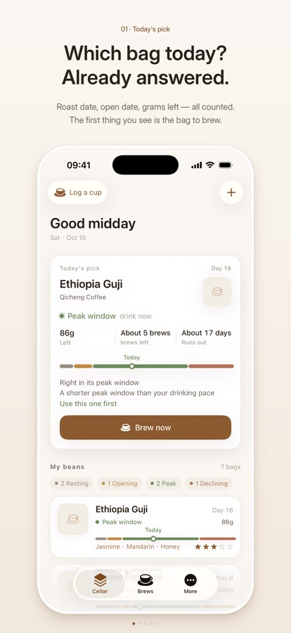
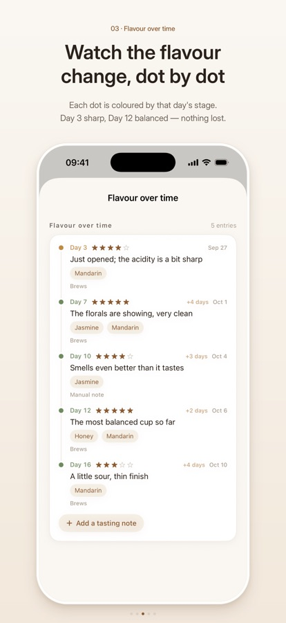
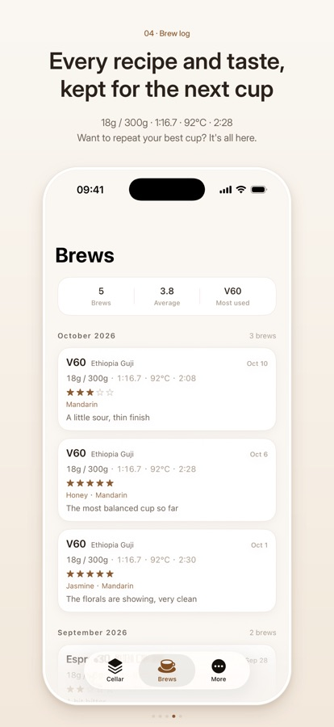
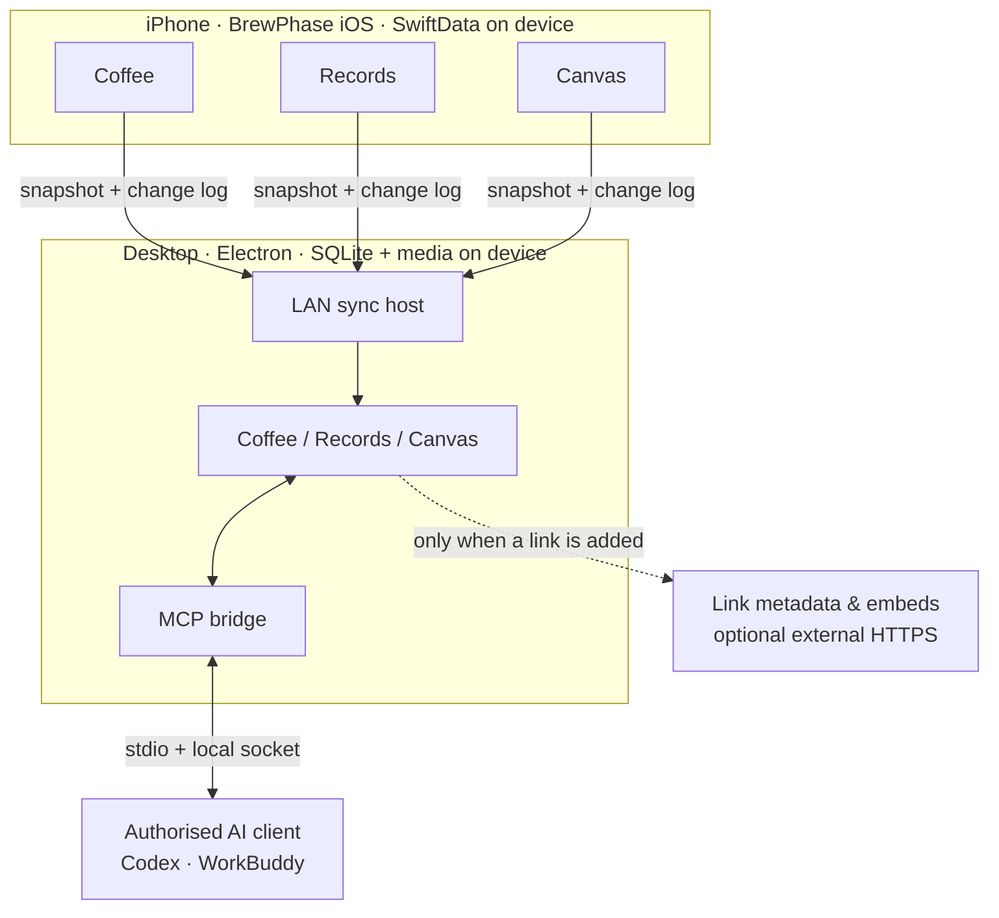

# BrewPhase

|   |   |
| - | - |

> English | [简体中文](README.zh-CN.md)

<p align="center">
  
</p>

**A quiet place for coffee — and everything around it.**

BrewPhase began as a coffee notebook: follow a bag from its roast date to the last cup, watch how
its flavour moves, and learn from your own brews. It is growing into something wider — a place to
keep the notes, links and images you collect, and to arrange them in a space that belongs to you.

*Log the coffee. Keep the life around it. Over time, your own records become a place worth returning to.*

<div align="center">


</div>

The `Desktop Release` badge points to a real workflow, but it is a **packaging** workflow: it runs
only on `desktop-v*` tags or manual dispatch. This repository has no test-on-every-push CI yet.

> **Which version is this README about?** The App Store build is **1.1**, a coffee notebook for
> iPhone. The Coffee / Records / Canvas workspace, the desktop companion and MCP live in `main`
> (`2.0` in the Xcode project) and are **implemented but not distributed**. See
> [Platform status](#-platform-status).

## ⬇️ Download

| Platform              | Get it                                                                                                                                            |
| --------------------- | ------------------------------------------------------------------------------------------------------------------------------------------------- |
| **iPhone · iOS 18+**  | **[BrewPhase 1.1 on the App Store](https://apps.apple.com/us/app/brewphase/id6815591631)** — free, US storefront, English + Simplified Chinese    |
| **macOS · Desktop**   | **[BrewPhase Desktop 0.1.0 — macOS arm64 (prerelease)](https://github.com/banmu123/BrewPhase/releases/tag/desktop-v0.1.0)** — Developer ID signed, notarized, stapled; Apple Silicon only. |
| **Windows · Desktop** | **[BrewPhase Desktop 0.1.0 — Windows x64 (prerelease)](https://github.com/banmu123/BrewPhase/releases/tag/desktop-v0.1.0)** — NSIS `.exe` + `.sha256`, unsigned (SmartScreen will warn), not yet installed/smoke-tested on a real Windows machine. |
| **Linux · Desktop**   | No artifact. An `AppImage` target is kept in the config only; it is not built or verified.                                                        |
| **Source**            | `git clone https://github.com/banmu123/BrewPhase.git`                                                                                             |

The [Releases page](https://github.com/banmu123/BrewPhase/releases) carries
**desktop-v0.1.0** (prerelease, published 2026-11-10): a signed + notarized macOS arm64
`.dmg`/`.zip` and an unsigned Windows x64 NSIS `.exe`, each with `.sha256` files,
anonymous-downloadable. The Windows build has no Authenticode signature yet, so Windows Defender
SmartScreen will warn; MCP V1 is macOS/Linux-only and is not supported in the Windows build. The
download entry inside the iOS app points at this same Releases page — there is no external download
site to keep in sync. The canonical, dated record is
[docs/PROJECT\_STATUS.md](docs/PROJECT_STATUS.md).

## 📸 Screenshots

<p align="center">
  
  
  
</p>
<p align="center">
  <sub><b>BrewPhase 1.1 on iPhone</b> \&nbsp;·\&nbsp; today's pick \&nbsp;·\&nbsp; flavour over time \&nbsp;·\&nbsp; brew log — official App Store screenshots</sub>
</p>

These three frames show the **shipped 1.1 build**. Records, Canvas and the desktop app in `main`
have not been released and are not pictured; the older simulator captures in
[`docs/screenshots/`](docs/screenshots/) predate the current three-tab interface and are kept as
verification evidence, not as product imagery.

## What BrewPhase is — and what it is not

**BrewPhase is not an AI app you have to turn on before it becomes useful.** The foundation is your
own data: what you brewed, what you saved, what you noticed. AI access is an optional, explicitly
authorised door on the desktop — the app works, and is worth using, with that door closed.

It is also not a cloud service. There is no account, no hosted database and no sync server operated
by the project. Your iPhone keeps its own SwiftData store; the desktop app keeps its own SQLite file
and media directory. When you choose to connect them, they talk directly over your local network.



Three modules answer three different questions. **Coffee** asks *what do I have, how did I brew it,
and when should I drink it*. **Records** asks *what did I keep, and can I find it again*. **Canvas**
asks *what happens when I put these things next to each other*. Together they turn a logbook into a
personal space — not a feed, not a dashboard, and not a knowledge base you have to maintain for its
own sake.

**Not in scope:** accounts and cloud sync, a social feed, automatic AI organisation of your data,
and turning Canvas into a flowchart or whiteboard tool.

## ✨ Features

Coffee is the shipped part. The [App Store listing](https://apps.apple.com/us/app/brewphase/id6815591631)
documents bean management, editable phase rules and reminders, brew and tasting logs, on-device
insights, Ask, export and full backup; the list below describes `main`, which adds refinements such
as the inventory ledger and quick log. Records, Canvas, Desktop and MCP exist in `main` only —
implemented, but **not yet released**.

### ☕ Coffee

- **Every bag** — roaster, origin, process, roast level, roast and opening dates, remaining weight,
  and an inventory ledger that deducts the grams a brew actually used.
- **Flavour phases** — editable rules derive resting, peak-window and declining phases from the
  roast date; reminders can nudge you while a bag is at its best. These are brewing guides, not
  expiry dates.
- **Brews and tastings** — method, dose, water, temperature, time, grind, ratio, rating and notes;
  a flavour timeline, brew history, and a 30-second quick log.
- **Your own patterns** — on-device insights from better-rated cups and parameter ranges, plus
  *Ask*, which searches a bundled coffee knowledge base together with your own records. An optional,
  user-configured Ollama server can be enabled in advanced settings.
- **Your data, portable** — JSON and CSV export, and a full backup (including images) with
  integrity-checked restore.

### 🗂 Records

- Four carriers — **link, image, video and text** — with local persistence for imported media.
- Tags with many-to-many links, full-text search, and filters by carrier and tag.
- Platform-aware cards for GitHub, YouTube, Bilibili, X and generic web pages, plus local media;
  missing metadata falls back instead of being invented.
- Link metadata resolution runs in the desktop main process with SSRF protection, DNS checks,
  redirect validation and size limits. It writes to a separate derived table, so automatic lookups
  never create fake sync conflicts or overwrite a title you wrote.

### 🧩 Canvas

- An infinite canvas with pan and zoom; nodes keep **world coordinates**, so zooming never moves
  your layout.
- Add records from Records, drag and select nodes, write notes on a node, and keep the same record
  on several canvases — a canvas node is a placement, not a copy.
- Multiple canvases with thumbnails computed from the actual node bounds.

### 🖥 Desktop companion

- Electron app with the same three modules, wide-screen layout and a local SQLite database.
- Acts as the **host** for LAN sync: pairing QR code, incremental change log, chunked media transfer
  with SHA-256 verification and resume, conflict reporting, device revocation, and a scoped
  "clear synced content" action.
- Bilingual UI (English / Simplified Chinese); packaging for macOS, Windows and Linux is configured.

### 🤖 MCP / AI Action Gateway

- Lets an AI client you authorised — Codex, WorkBuddy or any MCP client — read and write a **bounded**
  part of your BrewPhase data. 18 tools covering Records read/create/update, Coffee read, and
  controlled Canvas writes.
- **Per-client authorisation** with 8 scopes. Tokens are shown once, supplied through an environment
  variable, and stored only as SHA-256 hashes on the desktop side.
- The MCP server speaks **stdio**; a **local Unix domain socket** bridges it to Electron's main
  process. No TCP listener, no public endpoint.
- Write operations are audited in `mcp_operation_log` and protected by idempotency keys and
  optimistic concurrency. There is **no SQL, no filesystem access, no delete tool and no media
  upload**. MCP writes are desktop-local and are not pushed back to iOS.
- Full setup lives in [`Desktop/README.md`](Desktop/README.md#mcpai-action-gateway); the trust
  boundary is in [`Desktop/docs/MCP_SECURITY.md`](Desktop/docs/MCP_SECURITY.md).

## 🔄 How it works

Four boundaries are worth keeping separate:

| Boundary                    | What crosses it                                                                           | How                                                                                                                                                                      |
| --------------------------- | ----------------------------------------------------------------------------------------- | ------------------------------------------------------------------------------------------------------------------------------------------------------------------------ |
| **On-device storage**       | Nothing leaves the device                                                                 | iOS: SwiftData in the app sandbox. Desktop: `brewphase.db` (SQLite) plus a media directory under Electron's `userData`.                                                  |
| **Local network**           | iPhone → Desktop sync data and media                                                      | Plain HTTP on the LAN (preferred port 47821). One-time pairing code, per-device bearer token, and HMAC-signed writes with timestamp + nonce.                             |
| **Optional external HTTPS** | Link metadata, remote preview images, embedded players, optionally your own Ollama server | Only when you add a link, open a player, or explicitly configure Ollama. Desktop lookups are SSRF-guarded; embeds are restricted to YouTube and Bilibili player domains. |
| **MCP local IPC**           | Scoped tool calls between a local AI client and the desktop app                           | stdio → Unix domain socket → Electron main. No network socket.                                                                                                           |


1. On the phone, Coffee, Records and Canvas share one local SwiftData store.
2. On the desktop, the same entities live in SQLite; the desktop owns its own derived metadata and
   never reads the phone's database file.
3. Pairing exchanges a short-lived, single-use code for a device token. Sync then sends a snapshot
   followed by a change log; media moves in 256 KB chunks with a whole-file hash check.
4. Conflicts are **reported**, not silently resolved by last-write-wins. Revoking a device invalidates
   its token; clearing removes synced content on the desktop, including coffee data recorded there.
5. MCP is a separate, opt-in path. It never turns the desktop into a server for the internet.

**Local-first is not the same as offline-only.** Core coffee logging works without any network, and
there is no telemetry — but link previews, remote thumbnails, embedded players, optional Ollama and
LAN sync all use the network. The LAN leg is **unencrypted HTTP**; HMAC protects integrity and
replay, not confidentiality. TLS is planned, not shipped.

## 📦 Platform status

| Platform | Status | Notes |
|---|---|---|
| **iOS · App Store** | **Available** — [1.1](https://apps.apple.com/us/app/brewphase/id6815591631) | iPhone only, iOS 18.0+, free, US storefront. Ships the Coffee notebook; no Records / Canvas / sync. |
| **iOS · `main` (2.0)** | **In development — not published** | Coffee + Records + Canvas + LAN sync exist in source. Not submitted as 2.0. |
| **macOS · Desktop** | **Published (prerelease)** | arm64 `.dmg` / `.zip` in `desktop-v0.1.0`, Developer ID signed + notarized + stapled. No Intel build. |
| **Windows · Desktop** | **Published (prerelease), unsigned** | NSIS x64 `.exe` in `desktop-v0.1.0`, built by the `windows-latest` CI job. No Authenticode certificate, not installed/smoke-tested on real hardware; MCP V1 unsupported. |
| **Linux · Desktop** | **Not supported yet** | `AppImage` target kept in the config; no build, no verification. |
| **MCP** | **Built, not published** | Desktop-only. macOS / Linux via Unix socket; Windows Named Pipe permissions unverified, no TCP fallback. |

*Built* means an artifact can be produced from this repository — it does **not** mean it is publicly
available. Minimum OS versions, test counts, signing details and known limitations are maintained in
**[docs/PROJECT_STATUS.md](docs/PROJECT_STATUS.md)** and nowhere else.

## 🚀 Getting started

### 1. On iPhone

Install [BrewPhase 1.1](https://apps.apple.com/us/app/brewphase/id6815591631) (iOS 18.0+). Add a
bag with its roast date, log a brew, and the flavour timeline starts filling itself in. No account,
no sign-in.

### 2. Desktop, from source

There is no public installer yet, so the only supported path today is building it:

```bash
git clone https://github.com/banmu123/BrewPhase.git
cd BrewPhase/Desktop
pnpm install
pnpm dev            # dev mode with HMR
```

Other scripts from [`Desktop/package.json`](Desktop/package.json):

```bash
pnpm typecheck      # tsc for both node + web configs
pnpm test           # Vitest unit + integration
pnpm build          # electron-vite build
pnpm start          # preview the built app
pnpm e2e            # Playwright + real Electron (local, needs a graphical session)
pnpm dist           # electron-vite build + electron-builder for the current platform
pnpm mcp:build      # standalone stdio MCP server -> out/mcp/stdio.mjs
```

The CI workflow uses **Node 22 + pnpm 10.34.5**. Do not run `pnpm e2e` while a dev instance is
running — they contend for the same single-instance lock and user data directory.

### 3. Pair iPhone with Desktop

Both devices must be on the same Wi-Fi.

1. In the desktop app, open **Settings → Device sync** and show the pairing QR code.
2. On iPhone, use the **Connect desktop** card on the Coffee home screen, or **More → Data →
   Desktop sync**, and scan it.
3. The code is single-use and valid for two minutes. After pairing, changes on the phone are pushed
   to the desktop; sync is **one-way (iOS → Desktop)** in v1.

Details, including conflict handling and device revocation, are in
[`Desktop/docs/REAL_DEVICE_SYNC_GUIDE.md`](Desktop/docs/REAL_DEVICE_SYNC_GUIDE.md) and
[`Desktop/docs/SYNC_PROTOCOL.md`](Desktop/docs/SYNC_PROTOCOL.md). The real-device end-to-end pass is
still in progress — see [Roadmap](#-roadmap).

### 4. MCP, if you want it

Create a scoped client token in the desktop app's **Settings → AI connections**, then point
your MCP client at `out/mcp/stdio.mjs`. Copy-pasteable `config.toml` and `mcp.json` live in
[`Desktop/README.md`](Desktop/README.md#mcpai-action-gateway) — we do not duplicate them here.

## 🔒 Privacy & security

- **No account, no telemetry.** Neither target integrates analytics, advertising, crash reporting or
  remote-config SDKs. Your records stay in the iOS app sandbox or the desktop's SQLite + media
  directory.
- **Tokens.** The iOS pairing token lives in the Keychain, never in `UserDefaults`. The desktop
  stores only `sha256(token)` in its `devices` / `mcp_clients` tables. MCP tokens are displayed
  once and passed to the server through an environment variable, not a command-line argument.
- **Scoped access.** Every MCP client gets its own token and a subset of 8 scopes. Every request is
  re-validated in Electron main; write calls are logged to `mcp_operation_log` without recording
  content, tokens or paths. There is no SQL, file or delete tool.
- **Electron hardening.** `contextIsolation`, sandbox, no Node integration in the renderer,
  Zod-validated IPC with sender checks, a custom media protocol and a Content Security Policy.
- **The LAN leg is plaintext HTTP.** There is no TLS yet. Bearer tokens, timestamps, nonces and
  HMAC-SHA256 signatures authenticate requests and prevent replay; they do **not** encrypt the
  payload. Treat pairing and sync as something to do on a network you trust.
- **Optional network egress.** Adding a link fetches metadata (and sometimes a remote preview
  image); opening a player loads a YouTube or Bilibili embed. Ask can be pointed at an Ollama server
  you configure yourself, in which case your question and retrieved excerpts go to that address.
  None of these are required for core coffee logging.
- **Privacy policy.** The source is [`docs/privacy.html`](docs/privacy.html) (bilingual). The public
  URL `https://banmu123.github.io/BrewPhase/privacy.html` is **currently 404** because GitHub Pages
  is not enabled for this repository; the policy also predates the Records / Canvas / sync features
  in `main` and needs an update before those ship. Both are tracked in
  [PROJECT_STATUS.md](docs/PROJECT_STATUS.md).

"Local-first" describes where your data lives and who controls it. It is not a promise that no
packet ever leaves your device.

## 🏗️ Architecture

- **iOS** — SwiftUI + SwiftData, Swift 5, iOS 18+, iPhone only. Pure logic in `Core/`; on-device
  retrieval, diagnostics and the Ask engine in `RAG/` with Core ML / Natural Language; a curated
  coffee knowledge base in `knowledge/`. UI text is localised through `L()` with a generated
  English / Simplified Chinese string table (`Tools/Localization/`).
- **Desktop** — Electron 45 + electron-vite, React 19, TypeScript, Vite. `main` owns SQLite
  (better-sqlite3 + Drizzle), the LAN sync host, metadata resolution and the MCP bridge;
  `renderer` is a React app with Konva for Canvas and Zustand for state; `preload` exposes a
  narrow, Zod-checked IPC surface.
- **Sync** — protocol v1 over LAN HTTP: one-time pairing, bearer identity, HMAC-signed writes,
  snapshot → change log → chunked media, and explicit conflict reporting.
- **MCP** — a standalone stdio server (MCP SDK) connected to Electron main through a `0700`
  directory / `0600` Unix socket and newline-delimited JSON. No TCP listener, no Windows support
  in V1.
- **Security model** — two complementary documents:
  [`Desktop/docs/SECURITY_MODEL.md`](Desktop/docs/SECURITY_MODEL.md) (Electron boundary) and
  [`Desktop/docs/MCP_SECURITY.md`](Desktop/docs/MCP_SECURITY.md) (AI-client boundary).

```
BrewPhase/                 # iOS app — SwiftUI + SwiftData
├── App/                   # entry point, schema, language manager
├── Features/              # Coffee · Records · Canvas · Settings · Bean · Brew · Ask …
├── Models/ · Core/        # @Model entities · pure domain logic
├── RAG/ · Services/       # on-device retrieval · link & media services
├── Sync/ · Shared/        # LAN sync client · components · theme · utilities
├── Resources/ · Assets.xcassets/
└── en.lproj/ · zh-Hans.lproj/
BrewPhaseTests/            # XCTest suite
Desktop/
├── src/main/              # SQLite · sync host · MCP bridge · metadata · window
├── src/preload/ · src/renderer/ · src/shared/ · src/mcp/
├── tests/ · docs/ · build/ · electron-builder.yml
docs/                      # PROJECT_STATUS · privacy policy · design system · screenshots
knowledge/                 # curated coffee knowledge base and its source registry
Tools/                     # localization · simulator / screenshot · analysis scripts
.github/workflows/         # desktop packaging workflow
```

## 📚 Documentation

Objective status — platform requirements, distribution, test counts, signing, limitations — lives
only in **[Project status](docs/PROJECT_STATUS.md)**. Everything else is here:

| Topic | Document |
|---|---|
| **Project status** (authoritative) | [docs/PROJECT_STATUS.md](docs/PROJECT_STATUS.md) |
| **Desktop development guide** | [Desktop/README.md](Desktop/README.md) |
| Product scope | [Desktop/docs/PRODUCT_SCOPE.md](Desktop/docs/PRODUCT_SCOPE.md) |
| Architecture | [Desktop/docs/ARCHITECTURE.md](Desktop/docs/ARCHITECTURE.md) |
| Data model mapping (iOS ↔ Desktop) | [Desktop/docs/DATA_MODEL_MAPPING.md](Desktop/docs/DATA_MODEL_MAPPING.md) |
| Sync protocol | [Desktop/docs/SYNC_PROTOCOL.md](Desktop/docs/SYNC_PROTOCOL.md) |
| Sync / metadata consistency | [Desktop/docs/SYNC_METADATA_CONSISTENCY.md](Desktop/docs/SYNC_METADATA_CONSISTENCY.md) |
| Real-device sync guide | [Desktop/docs/REAL_DEVICE_SYNC_GUIDE.md](Desktop/docs/REAL_DEVICE_SYNC_GUIDE.md) |
| Security model (Electron) | [Desktop/docs/SECURITY_MODEL.md](Desktop/docs/SECURITY_MODEL.md) |
| Canvas specification | [Desktop/docs/CANVAS_SPEC.md](Desktop/docs/CANVAS_SPEC.md) |
| MCP architecture | [Desktop/docs/MCP_ARCHITECTURE.md](Desktop/docs/MCP_ARCHITECTURE.md) |
| MCP tools (18) | [Desktop/docs/MCP_TOOLS.md](Desktop/docs/MCP_TOOLS.md) |
| MCP security | [Desktop/docs/MCP_SECURITY.md](Desktop/docs/MCP_SECURITY.md) |
| Roadmap | [Desktop/docs/ROADMAP.md](Desktop/docs/ROADMAP.md) |
| Feature parity audit | [Desktop/docs/FEATURE_PARITY_AUDIT.md](Desktop/docs/FEATURE_PARITY_AUDIT.md) |
| Design system | [docs/design/BrewPhase-Design-System-v1.md](docs/design/BrewPhase-Design-System-v1.md) |
| Workspace design | [Desktop/docs/CAFE_WORKSPACE_DESIGN.md](Desktop/docs/CAFE_WORKSPACE_DESIGN.md) |
| Reuse audit (BrewPing → BrewPhase) | [Desktop/docs/BREWPING_REUSE_AUDIT.md](Desktop/docs/BREWPING_REUSE_AUDIT.md) |
| Privacy policy (source) | [docs/privacy.html](docs/privacy.html) |
| Coffee knowledge base | [knowledge/SOURCE_REGISTRY.md](knowledge/SOURCE_REGISTRY.md) · [knowledge/_method/METHODOLOGY.md](knowledge/_method/METHODOLOGY.md) |
| Independent audit & analyses | [BrewPhase-Independent-Audit-2026-11.md](BrewPhase-Independent-Audit-2026-11.md) · [BrewPhase-DataConsistency-Phase1-2026-11.md](BrewPhase-DataConsistency-Phase1-2026-11.md) · [BrewPhase-Agent-Phase1-Analysis.md](BrewPhase-Agent-Phase1-Analysis.md) |


## 🤝 Development & contributing

**Requirements:** macOS with Xcode for the iOS target; Node 22 + pnpm 10.34.5 for the desktop.

```bash
# Desktop — the full local sanity check
cd Desktop
pnpm install
pnpm typecheck && pnpm test && pnpm build && pnpm e2e

# iOS — build and test with the simulator (see Tools/run.sh for the full flow)
xcodebuild test -scheme BrewPhase -destination 'platform=iOS Simulator,name=iPhone 16 Pro'

# Localization — regenerate + verify both string tables
python3 Tools/Localization/generate.py
python3 Tools/Localization/check.py
```

Test counts and how they were obtained are recorded in
[PROJECT_STATUS.md §4](docs/PROJECT_STATUS.md#4-test--ci-status); they are deliberately not
duplicated here. Playwright e2e needs a graphical session and is **not** part of CI.

**CI today:** [`.github/workflows/desktop-release.yml`](.github/workflows/desktop-release.yml) runs
typecheck → unit tests → build → packaging on macOS and Windows runners, but only on a
`desktop-v*` tag or manual dispatch. Installers are always uploaded as artifacts; a tag push also
creates a **draft** release, and a manual dispatch with `release_tag` uploads the packages as assets
of an existing release (used to add the Windows build to `desktop-v0.1.0`). There is no
pull-request CI yet.

**Contributing:** issues and pull requests are welcome, but there is no `CONTRIBUTING.md` and no
declared license yet (see [License](#-license)). For anything non-trivial, open an issue first so we
can agree on scope. Localised user-facing strings must go through `L()` and both `.lproj` tables.

## 🗺️ Roadmap

Direction, not commitments.

**Already implemented in `main`** (not necessarily shipped): Coffee, Records, Canvas, the desktop
companion, LAN sync, MCP V1, backup/restore, export, bilingual UI, packaging config.

**In progress**
- Real-device end-to-end validation of pairing, media transfer, conflicts and revocation.
- Windows install and smoke test on real hardware; Authenticode signing for the Windows installer.
- Updating the privacy policy for the newer feature set; a standalone download page is no longer
  planned (the iOS app links straight to GitHub Releases).
- Bonjour auto-discovery, TLS for LAN sync, and Intel Mac builds.

**Planned**
- Bidirectional sync, desktop video playback and system reminder scheduling.
- Canvas drawing tools — **only after** iOS gains the matching model, so nothing is claimed as
  cross-platform before it is.
- Automatic updates for the desktop app.

**Not planned:** accounts, cloud sync, a social feed, AI auto-organising your library, or turning
Canvas into a flowchart / whiteboard tool.

## ⚠️ Trademarks

Apple, App Store, Xcode and Swift are trademarks of Apple Inc. Codex is a trademark of OpenAI.
WorkBuddy, YouTube (Google), Bilibili, X, GitHub, Ollama, Electron, React and MCP are names or
trademarks of their respective owners. They appear here only to describe compatibility or the
technologies used; BrewPhase is not affiliated with, endorsed by, or sponsored by any of them.

## 📄 License

**No license has been declared yet.** This repository has no `LICENSE` file and GitHub reports no
detected license. Until the maintainer adds one, the default position is *all rights reserved* —
please open an issue before reusing, forking for distribution, or incorporating this code into
another project. The `License` badge at the top of this README points here deliberately.

## 🙏 Credits

- [Swift](https://www.swift.org/), SwiftUI and SwiftData — the iPhone app
- [Electron](https://www.electronjs.org/), [electron-vite](https://electron-vite.org/),
  [React](https://react.dev/), [TypeScript](https://www.typescriptlang.org/) and
  [Vite](https://vite.dev/) — the desktop app
- [SQLite](https://www.sqlite.org/) via [better-sqlite3](https://github.com/WiseLibs/better-sqlite3)
  and [Drizzle ORM](https://orm.drizzle.team/) — desktop storage
- [Konva](https://konvajs.org/) — Canvas rendering; [Zod](https://zod.dev/) — IPC validation;
  [Zustand](https://zustand-demo.pmnd.rs/) — renderer state
- [Model Context Protocol](https://modelcontextprotocol.io/) — the stdio AI gateway
- [Vitest](https://vitest.dev/) and [Playwright](https://playwright.dev/) — tests;
  [electron-builder](https://www.electron.build/) — packaging
- [shields.io](https://shields.io/) — README badges

BrewPhase ships its own curated coffee knowledge base under `knowledge/`; third-party sources are
listed in [knowledge/SOURCE_REGISTRY.md](knowledge/SOURCE_REGISTRY.md).
