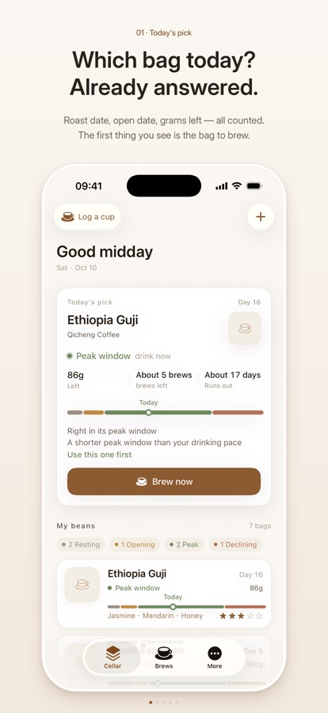
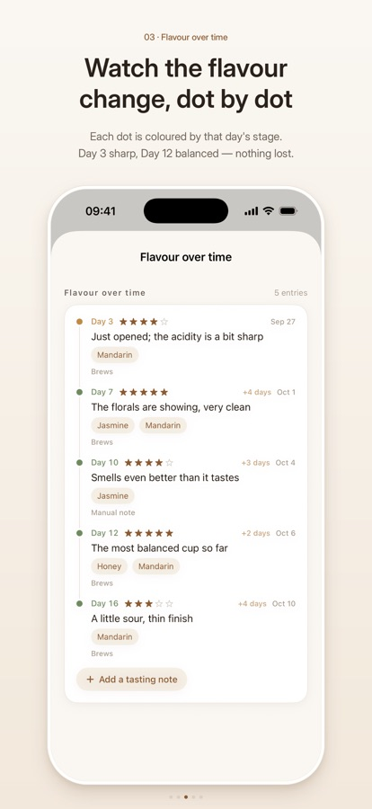
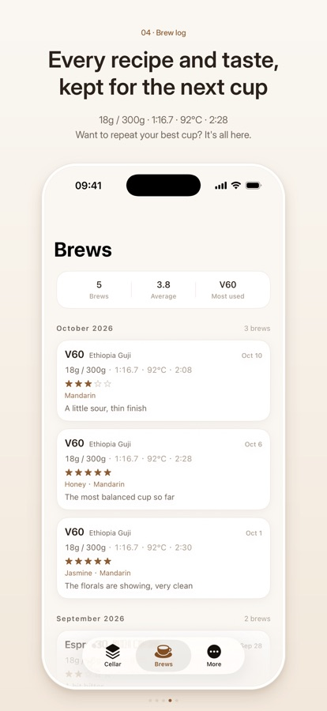
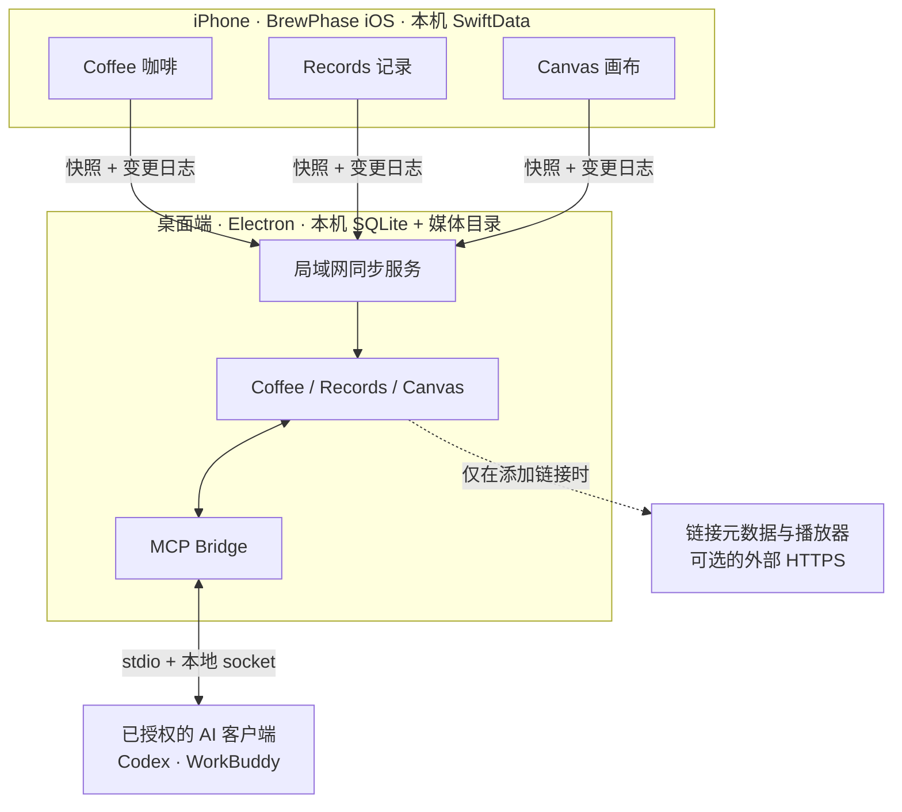

# BrewPhase

> [English](README.md) | 简体中文

<p align="center">
  
</p>

**一杯咖啡的安静角落，也是它周围那些事的落脚处。**

BrewPhase 起初是一本咖啡笔记：从烘焙日期跟着一包豆走到最后一杯，看风味怎么变化，从自己冲过的杯子里学到东西。它正在变得更宽一点——你记下的文字、收藏的链接、留下的图片，都可以放进来，再摆进一块属于你自己的空间。

*记录咖啡，也记录生活。时间久了，这些属于自己的数据，会慢慢变成一个你想回去看看的地方。*

<div align="center">

[](https://apps.apple.com/us/app/brewphase/id6815591631)
[](https://github.com/banmu123/BrewPhase)
[](https://github.com/banmu123/BrewPhase/actions/workflows/desktop-release.yml)


[](#-许可)

</div>

`Desktop Release` 徽章指向一个真实存在的工作流，但它是**打包**工作流：只在推送 `desktop-v*`
tag 或手动触发时运行。本仓库目前还没有「每次 push 都跑测试」的 CI。

> **这份 README 讲的是哪个版本？** App Store 上架的是 **1.1**，一本 iPhone 上的咖啡笔记。
> Coffee / Records / Canvas 工作区、桌面端和 MCP 都在 `main` 分支（Xcode 工程里是 `2.0`），
> **已实现但尚未发布**。详见[平台状态](#-平台状态)。

## ⬇️ 下载

| 端 | 获取方式 |
|---|---|
| **iPhone · iOS 18+** | **[App Store 上的 BrewPhase 1.1](https://apps.apple.com/us/app/brewphase/id6815591631)** —— 免费，美区，中英双语 |
| **macOS · 桌面端** | **[BrewPhase Desktop 0.1.0 — macOS arm64（prerelease）](https://github.com/banmu123/BrewPhase/releases/tag/desktop-v0.1.0)** — Developer ID 签名、已公证、已 staple；仅 Apple Silicon。 |
| **Windows · 桌面端** | 仅有未签名的 CI 产物（[打包工作流产出的 NSIS exe](https://github.com/banmu123/BrewPhase/actions/runs/42761926389)）；未进 Release，也未在实机安装验证过。 |
| **Linux · 桌面端** | 无产物。配置里保留了 `AppImage` target，仅此而已，未构建、未验证。 |
| **源码** | `git clone https://github.com/banmu123/BrewPhase.git` |

[Releases 页面](https://github.com/banmu123/BrewPhase/releases)已发布
**desktop-v0.1.0**（prerelease，2026-11-10）：已签名 + 公证的 macOS arm64
`.dmg`/`.zip` 与 `.sha256` 校验文件，可匿名下载。iOS 应用内的下载入口就指向这个
Releases 页面——没有需要两边同步的外部下载站。带日期的权威记录见
[docs/PROJECT_STATUS.md](docs/PROJECT_STATUS.md)。

## 📸 截图

<p align="center">
  
  
  
</p>
<p align="center">
  <sub><b>iPhone 上的 BrewPhase 1.1</b> &nbsp;·&nbsp; 今日推荐 &nbsp;·&nbsp; 风味变化 &nbsp;·&nbsp; 冲煮记录 —— App Store 官方截图</sub>
</p>

这三张展示的是**已上架的 1.1 版本**。`main` 里的 Records、Canvas 和桌面端还未发布，因此没有对应截图；
[`docs/screenshots/`](docs/screenshots/) 里较早的模拟器截图拍于三页导航改版之前，保留作验收证据，不作为产品展示图。

## BrewPhase 是什么，不是什么

**BrewPhase 不是一个要先打开 AI 才好用的应用。** 它的底子是你自己的数据：冲过什么、存过什么、注意到什么。
AI 接入是桌面端上一扇可选的、需要显式授权的门；把门关上，这个应用照样完整、照样值得用。

它也不是云服务。没有账号，没有托管数据库，也没有项目方运营的同步服务器。iPhone 用自己的 SwiftData 库，
桌面端用自己的 SQLite 文件和媒体目录。你选择把两端连起来时，它们在局域网里直接对话。



三个模块回答三个不同的问题。**Coffee** 问「我有什么豆、怎么冲的、什么时候该喝」；**Records** 问「我收过什么，
以后还找不找得回来」；**Canvas** 问「把这些东西放到一起，会看出什么」。合在一起，流水账才慢慢变成个人的空间——
不是信息流，不是数据看板，也不是一个需要你为它单独维护的知识库。

**明确不做**：账号与云同步、社交信息流、AI 自动替你整理数据，以及把 Canvas 做成流程图或白板工具。

## ✨ 核心功能

Coffee 是已经发布的那部分。App Store 商品页写明了豆子管理、可编辑的阶段规则与提醒、冲煮与品鉴记录、
设备端洞察、问一问、导出与完整备份；下面这份清单描述的是 `main`，它比上架版多了库存台账、快速记录等细节。
Records、Canvas、桌面端与 MCP 只存在于 `main` —— 已实现，但**尚未发布**。

### ☕ Coffee 咖啡

- **每一包豆** —— 烘焙商、产地、处理法、烘焙度、烘焙与开封日期、剩余克数；库存是台账，按冲煮实际用掉的克数扣减。
- **风味阶段** —— 可编辑的规则从烘焙日期推导养豆期、黄金窗口与衰退期，也能在窗口最好时提醒你。这些是冲煮建议，不是保质期。
- **冲煮与品鉴** —— 手法、粉量、水量、水温、时间、研磨、粉水比、评分与笔记；风味时间线、冲煮历史，还有 30 秒快速记录。
- **你自己的规律** —— 设备端从高分杯次与参数区间得出洞察；「问一问」会检索内置咖啡知识库和你自己的记录。高级设置里可自行配置 Ollama 服务。
- **数据带得走** —— JSON / CSV 导出，以及含图片的完整备份和恢复（带完整性校验）。

### 🗂 Records 记录

- 四种载体：**链接、图片、视频、文字**，导入的媒体持久化在本机。
- 多对多标签、全文搜索，以及按载体和标签筛选。
- GitHub、YouTube、B 站、X、通用网页与本地媒体各有差异化卡片；拿不到元数据就走 fallback，绝不编造。
- 链接元数据由桌面主进程抓取，带 SSRF 防护、DNS 校验、逐跳重定向检查与体积上限；结果写进独立的派生表，
  因此自动补全既不会制造假冲突，也不会覆盖你自己写过的标题。

### 🧩 Canvas 画布

- 无限画布，可平移缩放；节点保存的是**世界坐标**，缩放不会改动你的布局。
- 从 Records 添加素材、拖动与选中节点、给节点写备注；同一条记录可以出现在多块画布上——节点是一次摆放，不是副本。
- 多块画布，缩略图按真实节点包围盒计算。

### 🖥 桌面协同版

- Electron 应用，同样三个模块，宽屏布局，本机 SQLite 数据库。
- 作为局域网同步的 **Host**：配对二维码、增量变更日志、媒体分块传输（SHA-256 校验 + 断点续传）、冲突上报、
  设备撤销，以及有明确范围的「清空同步内容」。
- 中英双语界面；macOS / Windows / Linux 的打包配置已就位。

### 🤖 MCP / AI Action Gateway

- 让你**授权过**的 AI 客户端（Codex、WorkBuddy 或任意 MCP 客户端）在有限范围内读写 BrewPhase 数据：
  18 个工具，覆盖 Records 读写、Coffee 只读与 Canvas 受控写入。
- **逐客户端授权**，8 种 scope。Token 只显示一次，通过环境变量传给服务端，桌面端只保存 SHA-256 哈希。
- MCP Server 走 **stdio**；再经**本地 Unix domain socket** 连到 Electron 主进程。不监听 TCP，不暴露公网端点。
- 写操作记入 `mcp_operation_log` 审计，带幂等键与乐观并发。**没有 SQL、没有文件系统、没有删除工具、没有媒体上传**；
  MCP 写入是桌面本地的，不会回传 iOS。
- 完整配置见 [`Desktop/README.md`](Desktop/README.md#mcpai-action-gateway)，信任边界见
  [`Desktop/docs/MCP_SECURITY.md`](Desktop/docs/MCP_SECURITY.md)。

## 🔄 产品工作方式

有四条边界值得分开看：

| 边界 | 流过什么 | 怎么走 |
|---|---|---|
| **本机存储** | 不出设备 | iOS：App 沙盒里的 SwiftData。桌面端：Electron `userData` 下的 `brewphase.db`（SQLite）与媒体目录。 |
| **局域网** | iPhone → 桌面端的同步数据与媒体 | 局域网**明文 HTTP**（首选端口 47821）。一次性配对码、每设备独立 Bearer token，写请求带时间戳 + nonce + HMAC 签名。 |
| **可选的外部 HTTPS** | 链接元数据、远程预览图、嵌入式播放器、可选的自配 Ollama | 仅在你添加链接、打开播放器或显式配置 Ollama 时发生。桌面端抓取有 SSRF 防护；播放器只放行 YouTube 与 B 站域名。 |
| **MCP 本地进程通信** | 本地 AI 客户端与桌面应用之间的受限工具调用 | stdio → Unix domain socket → Electron 主进程，不使用网络端口。 |

1. 手机上，Coffee、Records、Canvas 共用一份本地 SwiftData 存储。
2. 桌面端有语义一致的实体，但存在自己的 SQLite 里；它还有自己派生的元数据，从不直接读手机的数据库文件。
3. 配对用短时、一次性的码换取设备 token；同步先发快照，再发变更日志，媒体按 256 KB 分块传输并做整文件哈希校验。
4. 冲突是**上报**给你裁决，不静默按「最后写入者胜」处理。撤销设备会作废其 token；清空会删除桌面端的同步内容，
   包括你在 Mac 上自己录入的咖啡数据。
5. MCP 是另一条独立、默认关闭的路径，它不会把桌面端变成公网服务器。

**本地优先不等于完全不联网。** 核心咖啡记录断网可用，也没有遥测；但链接预览、远程缩略图、嵌入式播放器、
可选 Ollama 与局域网同步都会用到网络。局域网这一段是**未加密的 HTTP**，HMAC 保护的是完整性与防重放，
不提供机密性。TLS 在计划中，尚未落地。

## 📦 平台状态

| 平台 | 状态 | 说明 |
|---|---|---|
| **iOS · App Store** | **已发布 Available** —— [1.1](https://apps.apple.com/us/app/brewphase/id6815591631) | 仅 iPhone，iOS 18.0+，免费，美区；只含 Coffee 笔记本，没有 Records / Canvas / 同步。 |
| **iOS · `main`（2.0）** | **开发中，未发布** | 源码里已有 Coffee + Records + Canvas + 局域网同步，尚未作为 2.0 提交。 |
| **macOS · 桌面端** | **已构建，未发布** | arm64 `.dmg` / `.zip`，Developer ID 签名 + 公证 + staple，放在未发布的草稿 Release 里。没有 Intel 构建。 |
| **Windows · 桌面端** | **开发中，无产物** | CI 里配置了 NSIS 打包，但从未构建，也没在 Windows 上装过、跑过。 |
| **Linux · 桌面端** | **暂不支持** | 配置里保留 `AppImage` target；无构建、无验证。 |
| **MCP** | **已构建，未发布** | 仅桌面端。macOS / Linux 走 Unix socket；Windows Named Pipe 权限未验证，不提供 TCP 退化。 |

「已构建」只表示能从本仓库产出产物，**不等于**可以公开获取。最低系统版本、测试数量、签名细节与已知限制统一维护在
**[docs/PROJECT_STATUS.md](docs/PROJECT_STATUS.md)**，其他文档不重复这些容易过时的数据。

## 🚀 开始使用

### 1. 在 iPhone 上

安装 [BrewPhase 1.1](https://apps.apple.com/us/app/brewphase/id6815591631)（iOS 18.0+）。加一包豆、填上烘焙日期，
再记一次冲煮，风味时间线就会自己长出来。不需要账号，也不需要登录。

### 2. 桌面端：从源码运行

目前没有公开安装包，唯一可用路径是自己构建：

```bash
git clone https://github.com/banmu123/BrewPhase.git
cd BrewPhase/Desktop
pnpm install
pnpm dev            # 开发模式，带 HMR
```

[`Desktop/package.json`](Desktop/package.json) 里的其他脚本：

```bash
pnpm typecheck      # node + web 两套 tsc 配置
pnpm test           # Vitest 单测 + 集成测试
pnpm build          # electron-vite 构建
pnpm start          # 预览构建产物
pnpm e2e            # Playwright + 真实 Electron（本机，需要图形会话）
pnpm dist           # electron-vite build + 当前平台的 electron-builder
pnpm mcp:build      # 独立 stdio MCP server -> out/mcp/stdio.mjs
```

CI 用的是 **Node 22 + pnpm 10.34.5**。不要在开发实例还开着时跑 `pnpm e2e`——两者会争抢单实例锁与同一个
userData 目录。

### 3. 让 iPhone 与桌面端配对

两台设备需要在同一个 Wi-Fi 下。

1. 桌面端打开 **设置 → 设备同步**，显示配对二维码。
2. iPhone 上用 Coffee 首页的「连接桌面端」卡片，或 **更多 → 数据 → 桌面同步** 扫码。
3. 二维码一次性使用、两分钟有效。配对后，手机上的变更会推送到桌面端；v1 的同步是**单向（iOS → 桌面端）**。

冲突裁决与设备撤销的细节见
[`Desktop/docs/REAL_DEVICE_SYNC_GUIDE.md`](Desktop/docs/REAL_DEVICE_SYNC_GUIDE.md) 和
[`Desktop/docs/SYNC_PROTOCOL.md`](Desktop/docs/SYNC_PROTOCOL.md)。真机端到端联调仍在进行中，见[路线图](#-路线图)。

### 4. 需要的话，再接 MCP

在桌面端 **设置 → AI 连接** 里创建带 scope 的客户端 token，再把 MCP 客户端指向 `out/mcp/stdio.mjs`。
可直接复制的 `config.toml` / `mcp.json` 在
[`Desktop/README.md`](Desktop/README.md#mcpai-action-gateway)，这里不重复。

## 🔒 隐私与安全

- **无账号、无遥测。** 两端都没有接入分析、广告、崩溃上报或远程配置 SDK。你的记录留在 iOS 沙盒，或桌面端的
  SQLite + 媒体目录里。
- **Token。** iOS 配对 token 存在 Keychain，不进 `UserDefaults`；桌面端 `devices` / `mcp_clients` 表只存
  `sha256(token)`。MCP token 只显示一次，通过环境变量传给服务端，不放在命令行参数里。
- **权限收窄。** 每个 MCP 客户端有独立 token 和 8 种 scope 的子集；每次请求都在 Electron 主进程重新校验，
  写调用记入 `mcp_operation_log`，且不记录正文、token 或路径。没有 SQL、文件或删除工具。
- **Electron 加固。** `contextIsolation`、sandbox、渲染层关闭 Node 集成、Zod 校验 IPC 并核对 sender、
  自定义媒体协议、CSP。
- **局域网这一段是明文 HTTP，尚无 TLS。** Bearer token、时间戳、nonce 与 HMAC-SHA256 签名用于身份校验和防重放，
  **不加密载荷**。请在你信任的网络里做配对和同步。
- **可选的外网出口。** 添加链接会抓取元数据（有时还有远程预览图），打开播放器会加载 YouTube 或 B 站嵌入页；
  「问一问」可以被指向你自己配置的 Ollama 服务，此时问题文本和检索片段会发往那个地址。核心咖啡记录不依赖以上任何一项。
- **隐私政策。** 源文件是 [`docs/privacy.html`](docs/privacy.html)（中英双语）。公开地址
  `https://banmu123.github.io/BrewPhase/privacy.html` **当前是 404**，因为本仓库尚未启用 GitHub Pages；
  这份政策也早于 `main` 里的 Records / Canvas / 同步功能，在这些能力发布前需要更新。两项都记在
  [PROJECT_STATUS.md](docs/PROJECT_STATUS.md) 里。

「本地优先」说的是数据放在哪里、由谁掌控，不是「一个数据包都不会离开设备」的承诺。

## 🏗️ 架构

- **iOS** —— SwiftUI + SwiftData，Swift 5，iOS 18+，仅 iPhone。纯逻辑在 `Core/`；`RAG/` 放设备端检索、诊断与
  「问一问」引擎（Core ML / Natural Language）；`knowledge/` 是人工整理的咖啡知识库。界面文案统一走 `L()`，
  由 `Tools/Localization/` 生成中英两张 `.lproj` 表。
- **桌面端** —— Electron 45 + electron-vite、React 19、TypeScript、Vite。`main` 持有 SQLite
  （better-sqlite3 + Drizzle）、局域网同步服务、元数据抓取与 MCP Bridge；`renderer` 是 React 应用，
  Canvas 用 Konva，状态用 Zustand；`preload` 只暴露一层经过 Zod 校验的窄 IPC。
- **同步** —— v1 协议跑在局域网 HTTP 上：一次性配对、Bearer 身份、HMAC 签名写入、快照 → 变更日志 →
  媒体分块，冲突显式上报。
- **MCP** —— 独立 stdio Server（MCP SDK），通过 `0700` 目录 / `0600` 权限的 Unix socket 与 Electron 主进程
  用 NDJSON 通信。不监听 TCP，V1 不支持 Windows。
- **安全模型** —— 两份互补文档：
  [`Desktop/docs/SECURITY_MODEL.md`](Desktop/docs/SECURITY_MODEL.md)（Electron 边界）与
  [`Desktop/docs/MCP_SECURITY.md`](Desktop/docs/MCP_SECURITY.md)（AI 客户端边界）。

```
BrewPhase/                 # iOS 应用 —— SwiftUI + SwiftData
├── App/                   # 入口、Schema、语言管理
├── Features/              # Coffee · Records · Canvas · Settings · Bean · Brew · Ask …
├── Models/ · Core/        # @Model 实体 · 纯领域逻辑
├── RAG/ · Services/       # 设备端检索 · 链接与媒体服务
├── Sync/ · Shared/        # 局域网同步客户端 · 组件 · 主题 · 工具
├── Resources/ · Assets.xcassets/
└── en.lproj/ · zh-Hans.lproj/
BrewPhaseTests/            # XCTest 测试
Desktop/
├── src/main/              # SQLite · 同步服务 · MCP Bridge · 元数据 · 窗口
├── src/preload/ · src/renderer/ · src/shared/ · src/mcp/
├── tests/ · docs/ · build/ · electron-builder.yml
docs/                      # PROJECT_STATUS · 隐私政策 · 设计系统 · 截图
knowledge/                 # 咖啡知识库与来源登记
Tools/                     # 本地化 · 模拟器/截图 · 分析脚本
.github/workflows/         # 桌面端打包工作流
```

## 📚 文档

客观状态——系统要求、发行情况、测试数量、签名、已知限制——只维护在
**[项目状态](docs/PROJECT_STATUS.md)** 一处。其余文档入口：

| 主题 | 文档 |
|---|---|
| **项目状态（权威）** | [docs/PROJECT_STATUS.md](docs/PROJECT_STATUS.md) |
| **桌面端开发文档** | [Desktop/README.md](Desktop/README.md) |
| 产品范围 | [Desktop/docs/PRODUCT_SCOPE.md](Desktop/docs/PRODUCT_SCOPE.md) |
| 架构 | [Desktop/docs/ARCHITECTURE.md](Desktop/docs/ARCHITECTURE.md) |
| 数据模型映射（iOS ↔ 桌面端） | [Desktop/docs/DATA_MODEL_MAPPING.md](Desktop/docs/DATA_MODEL_MAPPING.md) |
| 同步协议 | [Desktop/docs/SYNC_PROTOCOL.md](Desktop/docs/SYNC_PROTOCOL.md) |
| 同步 / 元数据一致性 | [Desktop/docs/SYNC_METADATA_CONSISTENCY.md](Desktop/docs/SYNC_METADATA_CONSISTENCY.md) |
| 真机同步联调指南 | [Desktop/docs/REAL_DEVICE_SYNC_GUIDE.md](Desktop/docs/REAL_DEVICE_SYNC_GUIDE.md) |
| 安全模型（Electron） | [Desktop/docs/SECURITY_MODEL.md](Desktop/docs/SECURITY_MODEL.md) |
| 画布规格 | [Desktop/docs/CANVAS_SPEC.md](Desktop/docs/CANVAS_SPEC.md) |
| MCP 架构 | [Desktop/docs/MCP_ARCHITECTURE.md](Desktop/docs/MCP_ARCHITECTURE.md) |
| MCP 工具（18 个） | [Desktop/docs/MCP_TOOLS.md](Desktop/docs/MCP_TOOLS.md) |
| MCP 安全 | [Desktop/docs/MCP_SECURITY.md](Desktop/docs/MCP_SECURITY.md) |
| 路线图 | [Desktop/docs/ROADMAP.md](Desktop/docs/ROADMAP.md) |
| 两端功能对齐审计 | [Desktop/docs/FEATURE_PARITY_AUDIT.md](Desktop/docs/FEATURE_PARITY_AUDIT.md) |
| 设计系统 | [docs/design/BrewPhase-Design-System-v1.md](docs/design/BrewPhase-Design-System-v1.md) |
| 工作空间设计 | [Desktop/docs/CAFE_WORKSPACE_DESIGN.md](Desktop/docs/CAFE_WORKSPACE_DESIGN.md) |
| 复用审计（BrewPing → BrewPhase） | [Desktop/docs/BREWPING_REUSE_AUDIT.md](Desktop/docs/BREWPING_REUSE_AUDIT.md) |
| 隐私政策（源文件） | [docs/privacy.html](docs/privacy.html) |
| 咖啡知识库 | [knowledge/SOURCE_REGISTRY.md](knowledge/SOURCE_REGISTRY.md) · [knowledge/_method/METHODOLOGY.md](knowledge/_method/METHODOLOGY.md) |
| 独立审查与分析 | [BrewPhase-Independent-Audit-2026-11.md](BrewPhase-Independent-Audit-2026-11.md) · [BrewPhase-DataConsistency-Phase1-2026-11.md](BrewPhase-DataConsistency-Phase1-2026-11.md) · [BrewPhase-Agent-Phase1-Analysis.md](BrewPhase-Agent-Phase1-Analysis.md) |

## 🤝 开发与贡献

**环境要求**：iOS 需要 macOS + Xcode；桌面端需要 Node 22 + pnpm 10.34.5。

```bash
# 桌面端 —— 本机完整检查
cd Desktop
pnpm install
pnpm typecheck && pnpm test && pnpm build && pnpm e2e

# iOS —— 构建与测试（完整流程见 Tools/run.sh）
xcodebuild test -scheme BrewPhase -destination 'platform=iOS Simulator,name=iPhone 16 Pro'

# 本地化 —— 重新生成并校验两张字符串表
python3 Tools/Localization/generate.py
python3 Tools/Localization/check.py
```

测试数量与统计方式记在 [PROJECT_STATUS.md §4](docs/PROJECT_STATUS.md#4-test--ci-status)，这里刻意不重复。
Playwright e2e 需要图形会话，**没有进 CI**。

**当前 CI**：[`.github/workflows/desktop-release.yml`](.github/workflows/desktop-release.yml) 在 macOS 与 Windows
runner 上跑 typecheck → 单测 → build → 打包，但只在推送 `desktop-v*` tag 或手动触发时执行。它把安装包上传为
artifact，并创建**草稿** Release，不会自动发布。目前还没有 PR 级 CI。

**贡献方式**：欢迎 issue 和 PR，但仓库暂时没有 `CONTRIBUTING.md`，也还没有声明许可证（见[许可](#-许可)）。
改动较大时建议先开 issue 对齐范围。面向用户的文案必须走 `L()`，并同步两张 `.lproj` 表。

## 🗺️ 路线图

方向，不是承诺。

**`main` 中已实现**（不代表已发布）：Coffee、Records、Canvas、桌面协同版、局域网同步、MCP V1、备份/恢复、
导出、双语界面、打包配置。

**进行中**
- 配对、媒体传输、冲突裁决与设备撤销的真机端到端验证。
- 双平台打包工作流的首次实跑；Windows 安装与冒烟测试。
- 部署下载页、发布已签名的 macOS 构建、更新隐私政策以覆盖新能力。
- Bonjour 自动发现、局域网同步的 TLS、Intel Mac 构建。

**计划中**
- 双向同步、桌面端视频播放与系统提醒调度。
- 画布手绘工具——**前提是** iOS 补上对应模型，在此之前不宣称跨端可见。
- 桌面端自动更新。

**不做**：账号、云同步、社交信息流、AI 自动整理你的资料库，以及把 Canvas 变成流程图 / 白板工具。

## ⚠️ 商标说明

Apple、App Store、Xcode、Swift 是 Apple Inc. 的商标；Codex 是 OpenAI 的商标；WorkBuddy、YouTube（Google）、
哔哩哔哩、X、GitHub、Ollama、Electron、React、MCP 等名称与商标归各自权利人所有。此处仅用于说明兼容性或所用技术，
BrewPhase 与上述任何一方均无隶属、背书或赞助关系。

## 📄 许可

**尚未声明许可证。** 本仓库没有 `LICENSE` 文件，GitHub 也未检测到许可证。在维护者补上之前，默认状态是
*保留所有权利*——如需复用、分发 fork 或把代码并入其他项目，请先开 issue 沟通。README 顶部的 `License`
徽章刻意指向这一节，而不是一个不存在的文件。

## 🙏 致谢

- [Swift](https://www.swift.org/)、SwiftUI、SwiftData —— iPhone 应用
- [Electron](https://www.electronjs.org/)、[electron-vite](https://electron-vite.org/)、
  [React](https://react.dev/)、[TypeScript](https://www.typescriptlang.org/)、[Vite](https://vite.dev/) —— 桌面端
- [SQLite](https://www.sqlite.org/) 与 [better-sqlite3](https://github.com/WiseLibs/better-sqlite3)、
  [Drizzle ORM](https://orm.drizzle.team/) —— 桌面端存储
- [Konva](https://konvajs.org/) —— Canvas 渲染；[Zod](https://zod.dev/) —— IPC 校验；
  [Zustand](https://zustand-demo.pmnd.rs/) —— 渲染层状态
- [Model Context Protocol](https://modelcontextprotocol.io/) —— stdio AI 网关
- [Vitest](https://vitest.dev/)、[Playwright](https://playwright.dev/) —— 测试；
  [electron-builder](https://www.electron.build/) —— 打包
- [shields.io](https://shields.io/) —— README 徽章

BrewPhase 自带整理过的咖啡知识库，放在 `knowledge/`，第三方来源登记见
[knowledge/SOURCE_REGISTRY.md](knowledge/SOURCE_REGISTRY.md)。
